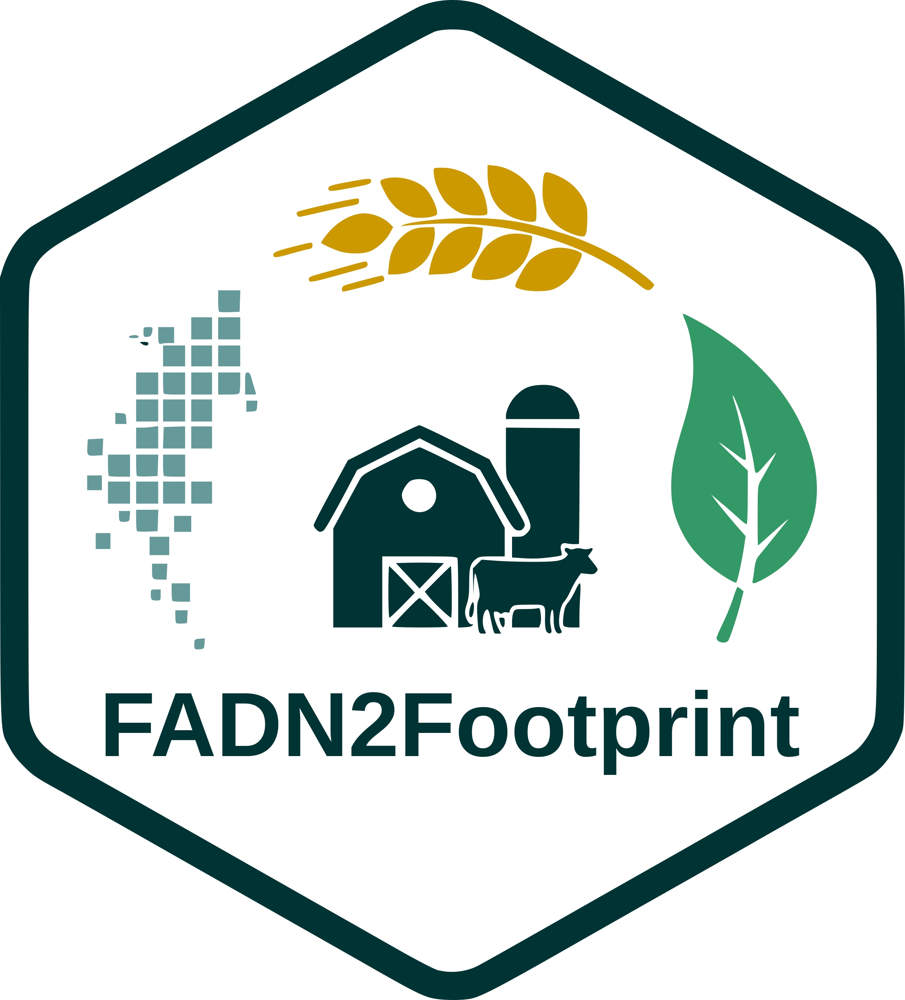

# FADN2Footprint: Agricultural practices and Environmental footprints from FADN data

 ██     ██  █████  ██████  ███    ██ ██ ███    ██  ██████
 ██     ██ ██   ██ ██   ██ ████   ██ ██ ████   ██ ██
 ██  █  ██ ███████ ██████  ██ ██  ██ ██ ██ ██  ██ ██   ███
 ██ ███ ██ ██   ██ ██   ██ ██  ██ ██ ██ ██  ██ ██ ██    ██
  ███ ███  ██   ██ ██   ██ ██   ████ ██ ██   ████  ██████
  
=================================================================

FADN2Footprint - DEVELOPMENT VERSION

=================================================================

This package has been validated ONLY for:
- Cereals farms (TF14 == 15)
- Dairy farms   (TF14 == 45)

Please filter your FADN data to these farm types before use.
Results for other farm types are STILL UNDER TEST and may be unreliable.

=================================================================

## Table of contents

-   [General infos](#general-infos)
-   [Intallation](#installation)
-   [Data available](#data-available)
-   [Peer-reviewed articles about
    FADN2Footprint](#peer-reviewed-articles-about-fadn2footprint)
-   [Other resources](#other-resources)

## General infos {#general-infos}

FADN2Footprint is an R library that transforms Farm Accountancy Data
Network (FADN) records into comprehensive sustainability assessments.
Estimates farm practices and computes environmental footprints (GHG
emissions, biodiversity, water), economic performance, and social
indicators at multiple scales (country, NUTS2, farm, activity, product)
using life cycle assessment principles and Scope 3 accounting.

## Installation {#installation}

This R package was built using R 4.5.0 and depends on R \>= 4.1.0

**Step 1: Install the devtools package**

`install.packages("devtools")`

**Step 2: Install FADN2Footprint**

`library(devtools)`

`install_github("sarah-huet/FADN2Footprint")`

**Step 3: Load FADN2Footprint**

`library(FADN2Footprint)`

## Data available {#data-available}

A mock FADN data set can be loaded from the FADN2Footprint package to
test it.

## Peer-reviewed articles about FADN2Footprint in preparation{#peer-reviewed-articles-about-fadn2footprint}

Huet S., Thomas L., Braquaval X., Rincon-Ariza F., Ayouba K., Bellassen V. (in prep.) *FADN2Footprint: Accountancy Data Unveil the Heterogeneity of European Farm Emissions*, **Targeted journal: Journal of Cleaner Production**

## Other resources {#other-resources}

The FADN2Footprint project also has a number of supporting online
resources, all described in the vignettes.

To post feature requests or ask for help, try [the FADN2Footprint Issue
Tracker](https://github.com/sarah-huet/FADN2Footprint/issues).
