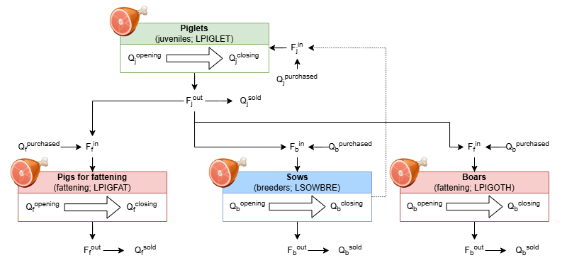
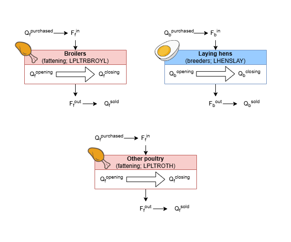

# Why agricultural practice inference is needed {#sec-method-practices-intro}

Our final objective is to estimate the environmental footprint of
agricultural products. This requires first to characterize farming
practices effectively implemented at the farm level, and that are not
directly registered in Farm Accountancy Data Network (FADN).
Specifically, we infer nine agricultural practices from FADN variables
and six more when adding Land Parcel Identification System (LPIS)
associated with Small Woody Feature (SWF) and Ground cover from
SENTINEL-2 data, and parameters from national greenhouse gas inventories
from UNFCCC (@tbl-practice-list).

::: {#tbl-practice-list}
+------------------+---------------+---------------+---------------+
|                  |               |               |               |
+==================+===============+===============+===============+
|                  | Data source / | FADN (+ Farm  | \+ LPIS & SWF |
|                  | Practices     | practices     | \| Parameters |
|                  |               | survey & feed | & SENTINEL-2  |
|                  |               | tables for    | \| from       |
|                  |               | allocation    | national      |
|                  |               | keys) data    | (farm level)  |
|                  |               |               | \| GHGIs      |
|                  |               |               | (yearly \|    |
|                  |               |               | national \|   |
|                  |               |               | averages) and |
|                  |               |               | \| other      |
|                  |               |               | reference     |
+------------------+---------------+---------------+---------------+
| Crop practices   | N fertilizer  | Hedge density |               |
|                  | quantity,     |               |               |
|                  | organic and   | Mean Field    |               |
|                  | mineral       | Size          |               |
|                  |               |               |               |
|                  | Pesticides    | Ground Cover  |               |
|                  |               |               |               |
|                  | Tillage       |               |               |
|                  |               |               |               |
|                  | Crop          |               |               |
|                  | Diversity     |               |               |
|                  |               |               |               |
|                  | Yields        |               |               |
+------------------+---------------+---------------+---------------+
| Grassland        | N Fertilizer  | Hedge density | Yield         |
| practices        | quantity,     |               | (Agreste SAA  |
|                  | organic and   |               | 2020)         |
|                  | mineral       |               |               |
|                  |               |               |               |
|                  | Livestock     |               |               |
|                  | density       |               |               |
+------------------+---------------+---------------+---------------+
| Herding          | Feed intake   |               | Manure        |
| practices        |               |               | Management    |
|                  | Rearing       |               | System        |
|                  | parameters    |               |               |
|                  |               |               | Animal Weight |
|                  | Production    |               |               |
|                  | yields        |               |               |
+------------------+---------------+---------------+---------------+

List of agricultural practices inferred by the FADN2Footprint package,
based on FADN data, potentially combined with data from LPIS, SWF,
SENTINEL-2, and national GHGIs.
:::

To infer these practices, we used several FADN primary variables:

::: {#tbl-practice-FADN-variable}
+-------------------------------+-------------------------------+
| Agricultural practices        | FADN variable                 |
+===============================+===============================+
| Mineral nitrogen quantity     | Crop areas (ha)               |
| (kgN/ha)                      |                               |
|                               | Amount of mineral nitrogen    |
|                               | fertilizer (kgN)              |
+-------------------------------+-------------------------------+
| Organic nitrogen quantity     | Crop areas (ha)               |
| (kgN/ha)                      |                               |
|                               | Feed intake (see below)       |
|                               |                               |
|                               | Animal number and category    |
+-------------------------------+-------------------------------+
| Pesticides (€/ha)             | Crop areas (ha)               |
|                               |                               |
|                               | Pesticides purchases (€)      |
+-------------------------------+-------------------------------+
| Tillage (L/ha)                | Crop areas (ha)               |
|                               |                               |
|                               | Off-road diesel purchases (L) |
+-------------------------------+-------------------------------+
| Crop diversity (Shannon       | Crop areas (ha)               |
| index, no unit)               |                               |
+-------------------------------+-------------------------------+
| Crop Yield (tDM/ha)           | Crop areas (ha) and           |
|                               | production (tDM)              |
+-------------------------------+-------------------------------+
| Livestock density (LU/ha)     | Grassland and feedcrops areas |
|                               | (ha)                          |
|                               |                               |
|                               | Animal number and category    |
+-------------------------------+-------------------------------+
| Feed intake (tDM/LU/yr)       | Crop production and\          |
|                               | sales                         |
|                               |                               |
|                               | Animal number and category    |
|                               |                               |
|                               | Feed purchases                |
+-------------------------------+-------------------------------+
| Rearing parameters (yr)       | Animal number and category    |
|                               |                               |
|                               | Animal sales and purchases    |
+-------------------------------+-------------------------------+
| Animal yield                  | Animal number and category    |
|                               |                               |
|                               | Animal product production     |
|                               | (milk, meat, ...)             |
+-------------------------------+-------------------------------+

FADN variables used to infer agricultural practices
:::

# Crop practices {#sec-method-practices-crops}

## Tillage {#sec-method-practices-tillage}

Tillage intensity (L diesel ha⁻¹) is estimated from farm-level off-road
diesel consumption. The direct-seeding reference is 54 L/ha, calculated
as the mean of the values for wheat (60 L/ha), maize (48 L/ha), and a
wheat–maize rotation (54 L/ha) reported by Chenu (2013). This reference
is multiplied by the farm's total recorded crop area, including
grassland. Any positive excess is divided by the farm's arable area to
obtain the tillage intensity assigned to arable crops; negative excess
is set to zero. Grassland is assigned a tillage intensity of zero. For
arable crop records with positive area on farms with arable area,
missing or non-positive off-road diesel consumption results in a missing
tillage intensity.

The implicit assumption is that average off-road diesel use on farms
practicing direct seeding broadly corresponds to diesel used for other
interventions than tillage. Tillage generally represents *43*% of
off-road diesel consumption due to mechanization in cereal fields (Chenu
and Butault, 2015), so total consumption is already highly correlated
with tillage intensity.

## Nitrogen fertilization {#sec-method-practices-Nferti}

The intensity of nitrogen fertilization is estimated for both mineral
and organic fertilizers. For mineral fertilizers, the amount of mineral
nitrogen brought to the farm is allocated to the different crops using
the French average mineral nitrogen input per crop as a distribution key
(Ministère De L’Agriculture - SSP, 2019) (see “PKGC_N_ferti” sheet of
Appendix C in Huet et al., 2026). The farm-level quantity is taken from
the FADN quantity variable where it is available (from 2017 onward). For
earlier years, it is inferred in two steps. First, mineral-N quantity is
estimated from fertiliser expenditure (SE295) using a country- and
year-specific ratio derived from FADN quantity-to-expenditure ratios and
Eurostat fertiliser price indices. This preliminary estimate is then
calibrated with a generalized additive model (GAM) fitted to FADN
observations from 2017 onward, when both expenditure and reported
quantity are available. The Tweedie GAM predicts reported quantity from
a smooth of the preliminary estimate, with country, farm type (TF14),
and economic size class (SIZC) as categorical effects; it is fitted by
REML with the smoothness parameter fixed at 10. Training observations
whose preliminary estimate exceeds its mean by more than three standard
deviations are excluded.

For pre-2017 farms with positive fertiliser expenditure, the model's
prediction on the log scale is exponentiated to give the inferred
quantity. If expenditure is not positive, the inferred quantity is set
to zero. From 2017 onward, the reported quantity is used directly where
available; it is not replaced by a model prediction when missing. During
prediction, TF14 classes 46 and 47 are mapped to class 45 to use the
fitted GAM coefficients; the recorded farm classification is unchanged.

For organic fertilizers, as the FADN variable is not well-informed, we
estimate these inputs in two different ways, depending on whether or not
the farm has livestock.

For farms without livestock, a standard value, equal to the French
average organic nitrogen input for farms that do not produce organic
manure is added to the different crops, distinguishing between organic
and conventional farms (ranging from 2.9 to 151 kgN/ha for conventional
soybean and fodder maize, respectively, Ministère De L’Agriculture -
SSP, 2019; see “PKGC_N_ferti” sheet of Appendix C in Huet et al., 2026).

For farms with livestock, we consider that the total amount of nitrogen
excreted by the farm herd is spread on-farm. The amount of nitrogen
excreted by livestock is calculated at the farm scale, and then
allocated among the different crops. The calculation of nitrogen
excretion by animals is based on the livestock population reported in
FADN and the estimation of the feed quantity and nutritional quality of
the ration provided to these animals (see Section 2.7.1), in accordance
with IPCC recommendations (Calvo Buendia et al., 2019; Eggleston et al.,
2006).

The allocation of excreted nitrogen to crops and grasslands uses the
all-farm average organic nitrogen input per hectare as a distribution
key, distinguishing between organic and conventional farms (Ministère De
L’Agriculture - SSP, 2019; see `data_extra$PKGC_N_ferti`). Averages and
confidence bounds for farms producing their own manure are used
separately to help define the lower and upper allocation thresholds (see
`data_extra$PKGC_N_ferti_org`).

If the resulting amount of the allocation for a given crop or grassland
is smaller than the lowest value between i) the French average organic
nitrogen input for farms that do not produce organic manure (e.g., 9.6
kgN/ha for conventional soft wheat) and ii) the lower bound of the 95%
confidence interval of the average of organic nitrogen inputs of farms
producing their own organic manure (e.g., 55 kgN/ha for conventional
soft wheat, Ministère De L’Agriculture - SSP, 2019), we assign the
lowest of these two values instead (implicitly concluding that despite
having a few animals, these farms import manure).

At the opposite, if the resulting amount is greater than the highest
value between i) the French average organic nitrogen input for farms
that do not produce organic manure (e.g., 9.6 kgN/ha for conventional
soft wheat) and ii) the higher bound of the *95*% confidence interval of
the average of organic nitrogen inputs of farms producing their own
organic manure (e.g., 116 kgN/ha for conventional soft wheat, Ministère
De L’Agriculture - SSP, 2019), we assign the highest of these two values
instead (implicitly concluding that these farms have too many animals
per hectare and therefore export manure).

In addition, the proportion of mineral nitrogen on total nitrogen input
to crops is used as an input variable for the biodiversity model
(Lindner et al., 2019).

## Pesticide use {#sec-method-pesticides}

The intensity of the application of pesticides is estimated using the
purchased value (€) in pesticides recorded in the FADN. This value is
allocated to the different crops using the national average Treatment
Frequency Index (TFI) as a distribution key (Ministère De
L’Agriculture - SSP, 2019) (see “IFT_ref” sheet of Appendix C). We
accounted for the lower toxicity of products used in organic farming by
correcting the value in pesticides of organic farms by the ratio between
the average toxicity of products used in organic farming and the average
toxicity of products used in conventional agriculture, estimated as
follows.

To assess the average toxicities of products used either in organic or
conventional farming, we estimate the toxicity by dose of four among the
top ten best-selling products in each of these production modes (BNV-D,
2020). We select these four products for the availability of data to
determine their toxicity, by multiplying their “freshwater ecotoxicity”
characterization factor (Andreasi Bassi et al., 2023) by their unit dose
(Ministère de l’agriculture, de l’agroalimentaire et de la forêt, 2017).
In line with the ADEME proposal for environmental labeling (ADEME,
2024), the characterization factor is doubled for organic molecules
compared to inorganic molecules (e.g., copper). Then, we calculate the
average toxicity of products used in organic or conventional agriculture
as the weighted average of the toxicity of the four products by the
corresponding number of unit doses (NODU) used in France in 2020 (see
“A.5.1_substance_top10” sheet of Appendix C in Huet et al., 2026). As a
result, we estimate that each euro spent on plant protection in organic
farms is 3.82 times less toxic than a plant protection euro in
conventional farms.

# Landscape variables {#sec-method-practices-landscape-var}

To take into account the landscape dimension of agricultural practices,
we estimate four parameters: hedge density, mean field size, crop
diversity and ground cover. To calculate the variables necessary for
estimating these parameters, we first extract from the French LPIS (IGN,
2020) all plots from farms registered our FADN database for the same
year.

To extract these plots, we use the PACAGE plot numbers (identification
number of the plot in the Common Agricultural Policy registration) as
primary join key. We face two situations:

- The farm has the same PACAGE number in FADN: then the LPIS plots with
  this PACAGE number are associated with that FADN-AC-FQS farm;

- No PACAGE number is registered in the FADN , or the PACAGE number in
  FADN does not correspond to a LPIS PACAGE number: no plot is
  associated the FADN holding. In 2020, such cases are found for 443 and
  318 metropolitan farms, respectively. These holdings are mainly
  concentrated in the OTEX viticulture, market gardening and pig and/or
  poultry farming.

This extraction results in a subsample of the LPIS that we intersect
with the Hedges layer of the BD TOPO® database (IGN and ASP, 2020) to
determine the variables required to estimate the three parameters.

## Hedge density {#sec-method-practices-hedge}

Hedge density is the ratio of the sum in linear meters of hedge to the
area of the holding (UAA). For the calculation of linear lengths, we use
the same procedure as previously used in a similar work at the scale of
the regions of France (Bamière et al., 2023).

Firstly, we expand the LPIS blocks. Hedges are not always inside,
outside or at the edge of LPIS blocks (all three cases present).
However, they rarely cut a block in half. The first step is to expand
the LPIS blocks by a buffer zone of 10 m. The length of 10 m for the
buffer zone is determined visually. It seems that beyond 10 m, it is
common to make mistakes when combining a hedge with two blocks which are
actually separated by a road. Conversely, below 10 m, it seems common to
fail to associate a hedge to a field which is clearly its direct
neighbour.

Secondly, we intersect the hedge lines with the expanded blocks to
determine a border length. There are four cases for each piece of hedge
from the intersection:

1.  The piece of hedge does not intersect any enlarged block. The piece
    of hedge is considered to be lined with non-agricultural uses on
    both sides and twice its length is assigned to “No crop”.

2.  The piece of hedge intersects a single expanded block. The piece of
    hedge is considered to be bordered by agricultural use on one side,
    and non-agricultural use on the other. Its length is assigned once
    to the crop/grassland type of the block and another time to “No
    crop”.

3.  The hedge piece intersects two blocks. The hedge piece is considered
    to be bordered on both sides by agricultural use. Its length is
    assigned once to the type of crop/grassland of each block.

4.  The piece of hedge intersects more than two blocks. Its length could
    then be affected more than twice, which would be absurd (hedge with
    more than two sides). To avoid this, the corresponding lengths are
    multiplied by the ratio of the initial length and the sum of the
    affected lengths so that the sum of the corrected lengths is exactly
    equal to twice the length of the actual hedge (two sides).

Then, to calculate the hedge density for each farm, we distinguish four
plot categories for each variable (hedge length and UAA):

- Total

- Permanent grassland (including grasslands, moors and alpine pastures)

- Arboriculture (including vines)

- Other crops

## Mean field size {#sec-method-practices-mean-field-size}

The mean field size is the ratio of the UAA to the number of plots. We
distinguish four plot categories for each variable (UAA and number of
plots):

- Total

- Permanent grassland (including grasslands, moors and alpine pastures)

- Arboriculture (including vines)

- Other crops

## Crop diversity {#sec-method-practices-crop-div}

We calculate the Shannon index (@eq-shannon), using the number of crops
as the number of species and the surface area as the abundance, only for
arable land use type at the farm scale:

$$H' = - \sum_{i=1}^{R} p_i ln p_i$$ {#eq-shannon}

where $R$ is the total number of crops, and $p$ is the ratio of the area
for the crop $i$ on the total arable area.

## Ground cover {#sec-method-practices-ground-cover}

The vegetation cover data is generated from the Sentinel-2 (S2) raster
data (European Space Agency, 2022). The native S2 data are reflectances
measured every 5 days in the optical range with 10 m resolution pixels
(Level 1C) in metropolitan France. Because of clouds, shadows, aerosols
optical thickness and water vapor, those data were not directly usable.
Therefore, they were corrected (to the so-called Level 2A) with the MAJA
atmospheric correction processor (https://www.cesbio.cnrs.fr/maja/). The
vegetation was then detected with a method based on the calculation of
the NDVI (Normalized Difference Vegetation Index; Araya et al., 2018;
Bockstaller et al., 2021) for the crop year 2020 (i.e., the period from
01/10/2019 to 30/09/2020, summing 366 days as 2020 is a leap year). The
NCD (Number of Covered Days) was then calculated: a day was counted as
“green” if the NDVI is greater than a threshold of 0.3 that separates a
bare soil state to a vegetated soil state (Araya et al., 2018). Because
of the big amount of native data to manipulate (about 4.5 TB), the NCD
at 10 m pixel level was produced using the IOTA2 processing chain
(https://docs.iota2.net/) on the CNES supercomputer HAL. From the NCD,
we calculated the plot average number of covered days using the area
statistics algorithm in QGIS (QGIS Development Team, 2022) for four plot
categories:

- Total

- Permanent grassland (including grasslands, moors and alpine pastures)

- Arboriculture (including vines)

- Other crops

The number of uncovered days is then calculated as: Number of uncovered
day = 366 – number of covered day.

# Practices in grasslands {#sec-method-practices-grasslands}

For grasslands, we consider four agricultural practices: hedge density,
total nitrogen fertilization as well as the share of mineral fertilizer
and livestock density, estimated as the number of grazing animals (e.g.,
cattle, sheep, horses) per hectare of main forage area (e.g., grass,
green maize). Indeed, permanent grasslands are not ploughed, do not
receive pesticides, and are not associated with any crop diversity. We
also considered negligible the effect of mean field size on biodiversity
in grasslands as few studies are available and report contradictory
effects (Dumont et al., 2016; Lescourret et al., 2025)). Permanent
grasslands also have a year-round ground cover. Note that temporary
grasslands are considered as crops as they are part of a crop rotation.

# Herding practices {#sec-method-practices-herding}

To estimate practices associated with livestock, we need to estimate
five main elements:

- herd/flock structure

- herd feed

- other inputs

- manure/waste management

- Animal products

When these elements are estimated, we can model the pseudo-farm by
gathering on-farm practices as well as off-farm ones (e.g., purchased
feed, breeders and juveniles needed to generate fattening livestock).
Then, we calculate the footprint of the whole pseudo-farm.

For herds, we subdivide animals, feed and waste to each farm activity
(e.g. milk vs specialized meat) as recommended (ILCD, 2010). However, we
cannot use subdivision for products coming from the same livestock
category (ie., milk and cull meat from dairy cows). When subdivision is
not possible, we allocate the environmental footprint to the different
co-products using an economic allocation.

## Herd structure {#sec-method-practices-herd-struct}

To estimate the herd structure in each farm, we use the FADN data on
numbers of animals in each livestock category (e.g., dairy cows,
fattening pigs) as well as sales and purchases to estimate in- and
outflows between categories and rearing parameters. Then, to account for
the off-farm animals that generated or have been generated by on-farm
animals (e.g., in a farm specialized in fattening, the off-farm
reproducing cows which mothered the fattening young bovines), we model a
theoretical herd at equilibrium for each livestock category (i.e.,
encompassing both off- and on-farm animals needed to maintain the
observed on-farm animal numbers), using stocks, flows and rearing
parameters of the farm. We call it the pseudo-herd. Note that for
poultry, we consider off-farm animals negligible (e.g., the hens that
generated the broilers) and hence neglect flows between categories.

### Restrain pseudo-herd animals to farm activities {#sec-restrain-activities}

#### Dairy cattle {#sec-restrain-dairy-cattle}

We first identify the on-farm cattle needed to maintain the dairy-cow
herd. This requires estimating animal flows and rearing parameters from
FADN stocks, purchases, and sales, as described below. The same
flow-and-rearing approach is used for the dairy-sheep flock (see
@sec-restrain-other-animals).

##### Modeling the rearing process {#sec-method-practices-rearing}

For cattle, sheep, swine, and poultry, we classify livestock categories into
three rearing stages: juveniles, fattening, and breeders
(@fig-herd-flows). Only FADN livestock categories for which at least one
animal occurs in the full dataset are included.

::: {#fig-herd-flows}
 


 

Rearing process charts for cattle, swine and poultry. For each livestock
category, the corresponding rearing stage (i.e., juveniles in green,
fattening in red, and breeders in blue) and the FADN code are mentioned
in brackets.
:::

FADN reports the average number of animals in each livestock category,
as well as opening and closing stocks, purchases, and sales. We use the average number
(variables ending by "AN") as the observed stock used in the following calculations.
If the average number is not available, the observed stock is calculated from the average livestock unit using the conversion coefficient for the category.

##### Estimation of flows

While flows between categories are unknown, outflows of the last rearing
stages (e.g., LCOWDAIR, LBOV2) correspond to $F^{out} = Q^{sales}$ and serve as basis to
calculate other flows, by tracing back flows upward the rearing process.
Hence, using outflows of the last rearing stage as well as quantities
registered in the FADN for each livestock category (i.e., average,
opening, closing, purchases, and sales numbers), we estimate flows of
animals transiting through each livestock category as:

$$F_{l}^{in} = Q_{l}^{purchases} + \Delta \text{Stock}_{l} + F_{l}^{out}$$
{#eq-Fin}

Here, $F_l^{in}$ and $F_l^{out}$ are annual animal flows into and out of
category $l$ (heads/year); $Q_l^{purchases}$ is the FADN number
purchased for that category (heads/year); and $\Delta\text{Stock}_l$ is
the change in stock (heads) defined below. The input quantities are
FADN animal records.

$$\Delta \text{Stock}_l = Q_{l}^{closing} - Q_{l}^{opening}$$
{#eq-delta_stock}

Here, $Q_l^{closing}$ and $Q_l^{opening}$ are the FADN closing and
opening stocks for category $l$ (heads).

$$F_{l-1}^{out} = Q_{l-1}^{sales} + \sum_{k \in L} (F_{k}^{in} - Q_{k}^{purchases})$$
{#eq-Fout}

Here, $F_{l-1}^{out}$ is the inferred outflow from the preceding
rearing category (heads/year), $Q_{l-1}^{sales}$ is its FADN sales
(heads/year), and $L$ is the set of categories directly below it in the
rearing process. For each such category $k$, $F_k^{in}$ and
$Q_k^{purchases}$ are the inferred inflow and FADN purchases
(heads/year), respectively.

Note that some farms can experience animal losses, resulting in negative
flows. Losses are not recorded, so they are generally assumed to be
null. When the resulting calculation produces negative inflows or
outflows, these are set to zero.

##### Estimation of rearing parameters {#sec-method-practices-rearing-param}

For each livestock category, we estimate the mean residence time (the
time spent in that category) as its stock divided by the mean of its
inflow and outflow rates:

$$t_{l} = \frac{\bar{Q}_{l}}{(F_l^{in}+F_l^{out})/2}$$
{#eq-rearing_time}

**Intuition.** A larger stock relative to the rate of animal turnover
means animals stay in the category longer.

Here, $t_l$ is the mean residence time in category $l$ (years),
$\bar{Q}_l$ is its observed stock from @eq-Qobs (heads), and $F_l^{in}$
and $F_l^{out}$ are the category's annual flows from @eq-Fin and
@eq-Fout (heads/year). These quantities are derived from FADN animal
stocks, purchases, and sales.

We estimate the number of offspring per female breeder per year as:

$$Offsprings = \frac{F_{j}^{in} - Q_j^{purchases}}{\bar{Q}_{b}}$$
{#eq-offspring_nb}

**Intuition.** This counts juvenile inflow not explained by purchases
and divides it by the observed breeder stock, attributing the remaining
juvenile inflow to births.

Here, $Offsprings$ is the estimated number of offspring per breeder per
year (offspring/breeder/year); $F_j^{in}$ is the annual inflow to the
juvenile stage (heads/year); $Q_j^{purchases}$ is the number of
juveniles purchased (heads/year); and $\bar{Q}_b$ is the observed
breeder stock (heads). The flow and stock inputs come from FADN.

For cattle, we also estimate the average age at first calving as the
average of the minimal age (i.e., 1 or 2 y.o.) plus residence time in
may-have-but-have-not-yet-calved breeding categories (e.g., breeding
part of the female bovine between 1 and 2 y.o. and heifers for breeding
which are \>2 y.o.) weighted by the observed number of animals.

Some livestock categories have zero quantities on some farms (for
example, a pig fattener without piglets or sows), so their rearing
parameters cannot be estimated. For cattle, non-finite parameters are
first replaced by the median among farms in the same NUTS2 region where
the category is present, when at least 15 such farms are available;
otherwise, the pre-computed reference median is used. Observed and
imputed values are then clipped to parameter-specific thresholds
derived from the pan-European reference distribution. If a value is
still missing, it is replaced by a weighted average for the same
YEAR × COUNTRY × NUTS2, falling back to YEAR × COUNTRY, weighted by
FADN economic size (`SYS02`). These corrections are applied to the
primary rearing parameters and again after subdividing mixed categories.

##### Reference median and thresholds for rearing parameters {#sec-r}

The lower and upper thresholds are selected from the 1st, 5th, or 10th
and 90th, 95th, or 99th percentiles, respectively, depending on the
stringency chosen by visually examining each parameter distribution
for outliers (`pseudoherd_reference_table.R`). A category with a
specified age also has a logically determined maximum residence time
(for example, female bovines aged 1–2 years cannot have a residence
time longer than one year). Values outside the selected interval are
replaced by the corresponding bound.

The reference medians and thresholds themselves are pre-computed once,
from the pan-European FADN data over 20XX-20XX, and bundled with the
package as the `reference_rearing_param` dataset
(`inst/scripts/pseudoherd_reference_table.R`); they are not recomputed
from the farms being processed.

##### Subdivision: estimation in mixed categories {#sec-method-practices-livestock-mixed-cat}

In rearing processes, some livestock categories encompass both animals
for fattening and for breeding. For instance in cattle, while heifers
(i.e., female more than two y.o. which have not yet calved) are already
distinguished in the FADN between fattening and breeding ones, female
below two y.o. are not (@fig-herd-flows). In such mixed category, only
the number of animals sold are differentiated between sales for
slaughtering and those for rearing. We consider that sales for rearing
are for breeding purposes and that sales for slaughter are fattened
animals (i.e., $Q_{B}^{sales}$ and $Q_{F}^{sales}$, respectively; see
section Animal products). For other numbers (i.e., observed, average,
opening, closing, and purchases) in these mixed categories, we
distinguish animals going to be fattened from those going to be breeders
based on their proportion in the downward flow of animals (see Eq.
@eq-mixed_cat for an example calculation of the observed number of
animals for fattening). For the mixed category LBOV1_2F, the downward
fattening flow consists of slaughter sales from that category plus the
inflow to LHEIFFAT not explained by purchases. The downward breeder flow
is the remaining outflow from LBOV1_2F.

$$
\begin{aligned}
F_{F,l}^{down} &= Q_{l,\mathrm{slaughter}}^{sales}
  + F_{l+1}^{in} - Q_{l+1}^{purchases} \\
F_{B,l}^{down} &= F_l^{out} - F_{F,l}^{down} \\
\bar{Q}_{F,l} &= \bar{Q}_{l} \cdot
  \frac{F_{F,l}^{down}}{F_{F,l}^{down} + F_{B,l}^{down}} \\
\bar{Q}_{B,l} &= \bar{Q}_{l} \cdot
  \frac{F_{B,l}^{down}}{F_{F,l}^{down} + F_{B,l}^{down}}
\end{aligned}
$$ {#eq-mixed_cat}

**Intuition.** A mixed category contains animals entering either the
fattening or breeder pathway. We infer the share of each pathway from
its downward flows, then allocate the category's observed stock in the
same proportions.

Here, $F_{F,l}^{down}$ and $F_{B,l}^{down}$ are inferred annual
outflows (heads/year) from mixed category $l$ into the fattening and
breeder pathways; $Q_{l,\mathrm{slaughter}}^{sales}$ is the FADN number
sold for slaughter from category $l$ (heads/year); $F_{l+1}^{in}$ and
$Q_{l+1}^{purchases}$ are the inflow and purchases for the next
category (heads/year); $\bar{Q}_l$ is the observed mixed-category stock
(heads); and $\bar{Q}_{F,l}$ and $\bar{Q}_{B,l}$ are the resulting
fattening and breeder stock estimates (heads). For `LBOV1_2F`,
$l+1$ is `LHEIFFAT`. The stock split is proportional to the inferred
downward flows; it does not use downstream stocks divided by residence
times. The underlying counts are FADN variables and the split-flow
terms are derived from @eq-Fin and @eq-Fout.

##### Assigning cattle to farm activities

The dairy-cow stock is assigned to milk. The required stocks of
replacement heifers, the breeding share of `LBOV1_2F`, and calves are
estimated from the dairy-cow turnover rate. The on-farm milk allocation
for each category is capped at the observed stock; any cattle stock
not needed for the dairy activity is allocated to beef.

$$
\begin{aligned}
\bar{Q}_{LCOWDAIR,\;milk} &= \bar{Q}_{LCOWDAIR} \\
\widetilde{Q}_{LHEIFBRE,\;milk} &=
  t_{LHEIFBRE}\left(\frac{\bar{Q}_{LCOWDAIR,\;milk}}{t_{LCOWDAIR}}\right) \\
\widetilde{Q}_{LBOV1\_2F,\;breeders,\;milk} &=
  t_{LBOV1\_2F,\;breeders}
  \left(\frac{\bar{Q}_{LCOWDAIR,\;milk}}{t_{LCOWDAIR}}\right) \\
\widetilde{Q}_{LBOV1,\;milk} &=
  1\ \mathrm{year}
  \left(\frac{\widetilde{Q}_{LBOV1\_2F,\;breeders,\;milk}}
  {t_{LBOV1\_2F,\;breeders}}\right)
\end{aligned}
$$ {#eq-restrain-herd-act}

**Intuition.** The cow replacement rate is the observed dairy-cow
stock divided by its residence time. Multiplying that rate by the
residence time of each replacement category gives the stock needed
there; the first juvenile step is treated as one year.

Here, $\bar{Q}_{l}$ is the observed on-farm stock of cattle category
$l$ (heads); $\bar{Q}_{l,\;milk}$ is the part assigned to milk
(heads); and $\widetilde{Q}_{l,\;milk}$ is the number needed for the
dairy renewal chain before the on-farm cap (heads). The $t$ terms are
the residence times in years from @eq-rearing_time; the category codes
are FADN cattle variables. The `LBOV1_2F` breeder component is obtained
from the mixed-category split in @eq-mixed_cat.

$$\bar{Q}_{l,\;milk} = \min(\bar{Q}_l,\widetilde{Q}_{l,\;milk})$$
{#eq-cap-dairy-activity}

**Intuition.** A farm cannot allocate more animals to milk than it
actually has in that category, so any unmet renewal requirement is
left for the off-farm estimate in @sec-pseudoherd-dairy-cattle.

Here, $\bar{Q}_{l,\;milk}$ is the on-farm number assigned to milk
(heads), $\bar{Q}_l$ is the observed stock (heads), and
$\widetilde{Q}_{l,\;milk}$ is the dairy-chain requirement (heads), for
the replacement categories above. All stock quantities are based on
FADN animal counts.

For the dairy-cattle activity, breeders are dairy cows (`LCOWDAIR`),
juveniles are calves (`LBOV1`), and fattening animals are those that
are neither juveniles nor breeders, namely `LBOV1_2F` and `LHEIFBRE`.

#### Beef cattle

All cattle on the farm that are not needed to maintain the dairy-cow
herd are allocated to the beef activity, as described in
@sec-restrain-dairy-cattle.

#### Other animals {#sec-restrain-other-animals}

##### Sheep

We estimate the number of dairy ewes from milk production, then
estimate the animals needed to maintain that dairy-sheep flock using
the same flow and rearing-parameter methodology as for dairy cattle
(see @sec-restrain-dairy-cattle). All other sheep are allocated to the
meat activity. In France, the assumed milk yield is 255 L/ewe/year
(0.255 tonnes/ewe/year; CAP2ER, 2025). For positive milk production:

$$Q_{LEWEBRE,\;milk} =
  \max\left(1,\operatorname{round}\left(\frac{prod_t}{0.255}\right)\right)$$
{#eq-restrain-sheep}

**Intuition.** Dividing farm milk production by the assumed annual
yield gives the number of dairy ewes; the minimum of one assigns a ewe
whenever the farm reports positive sheep-milk production.

Here, $Q_{LEWEBRE,\;milk}$ is the estimated number of ewes assigned to
milk (heads), and $prod_t$ is sheep-milk production reported in FADN
(tonnes/year). The value 0.255 is the assumed annual milk yield
(tonnes/ewe/year), from CAP2ER (2025); `round` rounds to the nearest
whole ewe.

##### Pigs

There is a single pig activity, meat, so all pigs are allocated to it.

##### Poultry

Laying hens are allocated to the egg activity. All other poultry
categories are allocated to the meat activity.

##### Goats

The existing activity allocation assigns all goats to milk.

### Pseudo-herd {#sec-method-practices-pseudoherd}

When considering only on-farm animals, one can miss the whole impact of
a production. For instance, dairy cows spawn more calves than needed to
renew the dairy herd and these additional calves can be slaughtered to
produce veal or raised longer to produce beef. Similarly, beef comes
from bovine animals that were once calves spawned from suckler cows: the
beef impact should hence encompass the slaughtered bovine impact as well
as the calve and suckler cow ones, even when these are not present on
the same farm. The pseudo-herd accounts for all animals involved in a
specific activity (e.g., slaughtered bovine, calves and suckler cows for
beef; fattening pigs, piglets and breeding sows for pork; etc.), whether
they are present on-farm or not (i.e., off-farm).

#### Dairy cattle {#sec-pseudoherd-dairy-cattle}

Start with all on-farm animals allocated to the dairy-renewal chain in
@sec-restrain-dairy-cattle. If those animals are insufficient to
maintain the observed dairy-cow herd, add the animals not present on the
farm that are needed to reach equilibrium. For dairy cattle, use only
the final (breeder) row of @tbl-pseudoherd_eq: the observed dairy cows
are the breeder reference stock, and the row gives the corresponding
juvenile and fattening headcounts. The rearing flows and parameters are
those already defined in @sec-restrain-dairy-cattle; they are not
re-estimated here.

#### Beef cattle {#sec-pseudoherd-beef-cattle}

The beef pseudo-herd includes all animals required for the beef
production chain, including animals not observed on the farm. First,
aggregate on-farm beef animals into the three rearing stages:
juveniles, fattening, and breeders. The observed quantity of stage
$s$ is:

$$\bar{Q}_s = \sum_{l=1}^{L_s}\bar{Q}_{l,\;meat}$$
{#eq-Qobs-stage}

**Intuition.** This combines the observed beef-activity stock of every
livestock category belonging to a rearing stage into one stage total.

Here, $\bar{Q}_s$ is the observed stock of stage $s$ (heads),
$\bar{Q}_{l,\;meat}$ is the on-farm number of category $l$ allocated
to beef (heads), and $L_s$ is the set of FADN categories in stage $s$.
For cattle, juveniles comprise `LBOV1`; fattening comprises
`LBOV1_2M`, `LBOV2`, `LBOV1_2F` fattening animals, and `LHEIFFAT`;
breeders comprise the breeding share of `LBOV1_2F`, `LHEIFBRE`,
`LCOWOTH`, and the dairy cows (`LCOWDAIR`) included in the observed
breeder reference.

The reference stage is the observed stage that is at least as large as
the equilibrium quantity implied by each of the other stages. For
cattle, if more than one stage satisfies this condition, the current
selection order is fattening, then juveniles, then breeders. Fattening
is inferred upwards from the juvenile and breeder stages; the juvenile
and breeder quantities are inferred in the direction requiring fewer
rearing parameters, using the offspring rate.

To estimate the complete herd involved in beef production, including
animals not on the farm, we calculate equilibrium headcounts from the
observed stage totals and the flows and rearing parameters defined in
@sec-restrain-dairy-cattle. Fattening is a terminal stage, so
equilibrium quantities based on fattening are inferred upwards.
Quantities in the fattening stage are inferred downwards from juveniles
or breeders. Juvenile and breeder quantities are linked through the
offspring rate. The cattle table below gives the equilibrium
headcounts implied by each observed reference stage.

For cattle, some juveniles are sold directly for veal rather than
entering fattening. The table's `adj_veal` factor accounts for that
direct-slaughter flow.

::: {#tbl-pseudoherd_eq}
```{r tbl-pseudoherd_eq, echo=FALSE, message=FALSE, warning=FALSE}

library(gt)
library(dplyr)

# Use MathJax inline delimiters for HTML rendering
allocation_data <- data.frame(
    row_label = c(
        "$$\\bar{Q}_{j}$$",
        "$$\\bar{Q}_{f}$$",
        "$$\\bar{Q}_{b}$$"
    ),
    col_j = c(
        "—",
        "$$t_j \\cdot \\left(\\frac{\\bar{Q}_{f}}{t_f}\\right) \\cdot \\frac{1}{\\text{adj}_\\text{veal}}$$",
        "$$t_j \\cdot \\bar{Q}_{b} \\cdot \\text{Offsprings}$$"
    ),
    col_f = c(
        "$$t_f \\cdot \\left(\\frac{\\bar{Q}_{j}}{t_j}\\right) \\cdot \\text{adj}_\\text{veal}$$",
        "—",
        "$$t_f \\cdot \\bar{Q}_{b} \\cdot \\text{Offsprings} \\cdot \\text{adj}_\\text{veal}$$"
    ),
    col_b = c(
        "$$\\frac{1}{\\text{Offsprings}} \\cdot (\\frac{\\bar{Q}_{j,meat}}{t_{j,meat}} + \\frac{\\bar{Q}_{j,milk}}{t_{j,milk}}) - Q_{LCOWDAIR}$$",
        "$$\\frac{1}{\\text{Offsprings}} \\cdot (\\frac{\\bar{Q}_{f,meat}}{t_{f,meat}} + \\frac{\\bar{Q}_{f,milk}}{t_{f,milk}}) - Q_{LCOWDAIR}$$",
        "—"
    ),
    stringsAsFactors = FALSE
)

# table ----
allocation_data |>
    gt() |>
    cols_label(
        row_label = md(""),
        col_j     = md("$$\\widehat{Q}_{j}$$"),
        col_f     = md("$$\\widehat{Q}_{f}$$"),
        col_b     = md("$$\\widehat{Q}_{b}$$")
    ) |>
    fmt_markdown(columns = everything()) |>
    # Row label column styling
    tab_style(
        style = list(
            cell_fill(color = "#1B4F72"),
            cell_text(color = "white", weight = "bold", align = "center")
        ),
        locations = cells_body(columns = row_label)
    ) |>
    # Column header styling
    tab_style(
        style = list(
            cell_fill(color = "#1A5276"),
            cell_text(color = "white", weight = "bold", align = "center")
        ),
        locations = cells_column_labels(columns = everything())
    ) |>
    # Alternating row backgrounds (excluding row_label column)
    tab_style(
        style     = cell_fill(color = "#D6EAF8"),
        locations = cells_body(columns = c(col_j, col_f, col_b), rows = c(1, 3))
    ) |>
    tab_style(
        style     = cell_fill(color = "#AED6F1"),
        locations = cells_body(columns = c(col_j, col_f, col_b), rows = 2)
    ) |>
    # Diagonal (—) cells highlighted
    tab_style(
        style = list(
            cell_fill(color = "#F0F3F4"),
            cell_text(color = "#717D7E", size = px(16), weight = "bold", align = "center")
        ),
        locations = list(
            cells_body(columns = col_j, rows = 1),
            cells_body(columns = col_f, rows = 2),
            cells_body(columns = col_b, rows = 3)
        )
    ) |>
    # Center all equation cells
    cols_align(align = "center", columns = everything()) |>
    # Column widths
    cols_width(
        row_label ~ px(130),
        col_j ~ px(220),
        col_f ~ px(220),
        col_b ~ px(220)
    ) |>
    # Footnotes
    tab_footnote(
        footnote  = md("$\\text{adj}_\\text{veal} = \\frac{(F_{LBOV1}^{out} - Q_{LBOV1}^{slaughter})}{F_{LBOV1}^{out}}$, if the species is bovine and $F^{out}_{LBOV1} > 0$, otherwise $\\text{adj}_\\text{veal} = 1$"),
        locations = cells_body(columns = c(col_j, col_f), rows = c(c(2), c(1, 3)))
    ) |>
    tab_footnote(
        footnote = md("For cattle, subtract observed dairy cows ($Q_{LCOWDAIR}$) from breeder equilibrium estimated from juveniles because dairy cows are included in the breeder quantity."),
        locations = cells_body(columns = col_b, rows = 1)
    ) |>
    tab_source_note(
        source_note = md(
            "**Notation:** &nbsp;
       $t$ = residence time in the category; &nbsp;
       $\\bar{Q}$ = observed number of animals; &nbsp;
       $\\widehat{Q}$ = estimated number of animals; &nbsp;
       $\\{j,f,b\\}$ = rearing stage (i.e., juveniles, fattening or breeders); &nbsp;
       $\\text{Offsprings}$ = number of offspring per breeder and per year"
        )
    ) |>
    tab_options(
        table.font.names                  = "Source Sans Pro, Calibri, sans-serif",
        table.font.size                   = px(13),
        table.border.top.color            = "#1B4F72",
        table.border.top.width            = px(3),
        table.border.bottom.color         = "#1B4F72",
        table.border.bottom.width         = px(2),
        column_labels.border.bottom.color = "#AED6F1",
        column_labels.border.bottom.width = px(2),
        data_row.padding                  = px(14),
        heading.background.color          = "#1B4F72",
        heading.title.font.size           = px(15),
        heading.subtitle.font.size        = px(12),
        footnotes.font.size               = px(10),
        footnotes.marks                   = "standard",
        source_notes.font.size            = px(10),
        table.width                       = pct(90)
    )
```

Equilibrium headcount calculations from observed headcounts for the
three rearing stages of cattle meat production. Each row is the observed
reference stage and each column is the corresponding estimated
equilibrium stage. Pigs use the same balancing approach by reference in
@sec-pseudoherd-other-animals; sheep and poultry have the stage
structures described there.
:::

**Intuition.** Each cell converts the observed count in the row's
reference stage into an equilibrium count for the column's stage.
Residence times convert between stock and flow, while the offspring
rate links breeders and juveniles. The `adj_veal` factor accounts for
calves sold directly for slaughter instead of entering fattening.

Here, $\bar{Q}_j$, $\bar{Q}_f$, and $\bar{Q}_b$ are observed stage
headcounts (heads); $\widehat{Q}_j$, $\widehat{Q}_f$, and
$\widehat{Q}_b$ are equilibrium headcounts (heads); $t_j$ and $t_f$
are the stage-level residence times (years); `Offsprings` is the
offspring rate (offspring/breeder/year); and $Q_{LCOWDAIR}$ is the
observed dairy-cow stock (heads), subtracted when juveniles or
fattening animals imply beef breeders. In the breeder-column formulas,
$\bar{Q}_{j,\;meat}$ and $\bar{Q}_{j,\;milk}$ are the observed juvenile
headcounts assigned to beef and milk, respectively; the corresponding
$\bar{Q}_{f,\;meat}$ and $\bar{Q}_{f,\;milk}$ are the observed
fattening headcounts for those activities; and $t_{j,\;meat}$,
$t_{j,\;milk}$, $t_{f,\;meat}$, and $t_{f,\;milk}$ are their
activity-specific residence times (years). Animal counts and sales are
FADN values; residence times and offspring rates are derived from the
FADN flows and stocks using @sec-restrain-dairy-cattle.

For the veal adjustment,
$\text{adj}_\text{veal} =
(F_{LBOV1}^{out}-Q_{LBOV1}^{slaughter})/F_{LBOV1}^{out}$ when the
bovine juvenile outflow is positive, and it is 1 otherwise. Here,
$F_{LBOV1}^{out}$ is the inferred annual `LBOV1` outflow
(heads/year), and $Q_{LBOV1}^{slaughter}$ is the FADN number of calves
sold directly for slaughter (heads/year).

The stage totals are defined in @eq-Qobs-stage. For cattle, the
fattening stage follows four routes to slaughter: `LBOV1_2M` direct to
slaughter, `LBOV1_2M` through `LBOV2` to slaughter, the fattening share
of `LBOV1_2F` direct to slaughter, and that share through `LHEIFFAT` to
slaughter. Let $D$ be the sum of the outflows from `LBOV1_2M` and the
fattening share of `LBOV1_2F`:

$$
\begin{aligned}
t_f ={}&
 t_{LBOV1\_2M,\;slaughter}
   \frac{Q_{LBOV1\_2M}^{slaughter}}{D}
 +(1+t_{LBOV2})
   \frac{F_{LBOV1\_2M}^{out}-Q_{LBOV1\_2M}^{slaughter}}{D} \\
&+t_{LBOV1\_2F,\;fattening,\;slaughter}
   \frac{Q_{LBOV1\_2F}^{slaughter}}{D}
 +(1+t_{LHEIFFAT})
   \frac{F_{LBOV1\_2F,\;fattening}^{out}
         -Q_{LBOV1\_2F}^{slaughter}}{D}
\end{aligned}
$$ {#eq-rt-f-cattle}

**Intuition.** Each route contributes its total residence time weighted
by the proportion of cattle taking that route; the extra one-year
terms account for time spent in `LBOV1_2M` or the fattening share of
`LBOV1_2F` before entering `LBOV2` or `LHEIFFAT`.

Here, $t_f$ is the beef fattening-stage residence time (years);
$D=F_{LBOV1\_2M}^{out}+F_{LBOV1\_2F,\;fattening}^{out}$ is the total
annual outflow across the two entry categories (heads/year);
$t_{LBOV1\_2M,\;slaughter}$ and
$t_{LBOV1\_2F,\;fattening,\;slaughter}$ are residence times before
direct slaughter (years); $t_{LBOV2}$ and $t_{LHEIFFAT}$ are residence
times in those FADN categories (years); and the $F^{out}$ and
$Q^{slaughter}$ terms are inferred annual outflows and FADN slaughter
sales (heads/year). These parameters are based on the FADN flows and
rearing parameters described in @sec-restrain-dairy-cattle.

Every estimated stage quantity is bounded below by the observed
quantity, $\widehat{Q}_s \geq \bar{Q}_s$. This ensures the pseudo-herd
does not omit animals actually on the farm; small differences between
the equilibrium equations can otherwise put an estimate slightly below
the observed stock because rearing parameters are rounded.

#### Other animals {#sec-pseudoherd-other-animals}

##### Sheep

Estimate the dairy-sheep renewal animals by the same method as for
dairy cattle (@sec-pseudoherd-dairy-cattle and
@sec-restrain-dairy-cattle). For the meat activity, estimate the
equilibrium numbers using the same observed-versus-implied balancing
principle described for beef cattle in @sec-pseudoherd-beef-cattle;
sheep have an "others" stage and a breeders stage rather than the
cattle three-stage structure.

##### Pigs

Pigs have a single meat activity, so use the three-stage equilibrium
balancing method described for beef cattle in
@sec-pseudoherd-beef-cattle. The pig stages are juveniles (`LPIGLET`),
fattening (`LPIGFAT`), and breeders (`LSOWBRE` and `LPIGOTH`).

##### Poultry

Off-farm poultry are considered negligible, so the pseudo-herd equals
the observed on-farm herd. Laying hens remain assigned to eggs and all
other poultry categories to meat (see @sec-restrain-other-animals).

#### Redistributing cattle equilibrium quantities across categories

The cattle stage-level equilibrium numbers
($\widehat{Q}_j$, $\widehat{Q}_f$, $\widehat{Q}_b$) are redistributed
across the individual FADN livestock categories in each stage.

For the juvenile stage (a single category, `LBOV1`), the full
equilibrium gap is attributed directly to `LBOV1`:

$$\widehat{Q}_{LBOV1,\;meat} = \bar{Q}_{LBOV1,\;meat} + (\widehat{Q}_{j} - \bar{Q}_{j})$$ {#eq-redistrib-j}

**Intuition.** The observed juvenile stock is retained, and the
difference between equilibrium and observed juvenile-stage totals is
added to it; calves sold directly for slaughter remain included
because they produce veal.

Here, $\widehat{Q}_{LBOV1,\;meat}$ and $\bar{Q}_{LBOV1,\;meat}$ are the
equilibrium and observed `LBOV1` stocks allocated to beef (heads), and
$\widehat{Q}_j$ and $\bar{Q}_j$ are the equilibrium and observed
juvenile-stage totals (heads), as defined in @eq-Qobs-stage and
@tbl-pseudoherd_eq.

For the fattening stage, which comprises several categories, the
equilibrium gap is distributed proportionally to the share of each
category $l$ in the *country-level* observed stock of its stage,
weighted by each farm's economic size (`SYS02`):

$$share_l =
  \frac{\sum_{\mathrm{farms}} \bar{Q}_l \cdot SYS02}
       {\sum_{\mathrm{farms}} \bar{Q}_s \cdot SYS02},
  \qquad l \in L_s$$ {#eq-share-cat}

**Intuition.** This assigns each livestock category a share of its
stage total based on its weighted share in the country's observed herd.

Here, $share_l$ is the dimensionless share for category $l$ in stage
$s$; $\bar{Q}_l$ is its observed stock (heads); $\bar{Q}_s$ is the
observed total stock of stage $s$ (heads); $SYS02$ is the farm's FADN
economic-size weight; and $L_s$ is the set of categories in that
stage. The sums use farms from the same country.

$$\widehat{Q}_{l,\;meat} =
  \bar{Q}_{l,\;meat} + (\widehat{Q}_{s} - \bar{Q}_{s}) \cdot share_l$$
{#eq-redistrib-category}

**Intuition.** Each category retains its observed beef-activity stock
and receives its share of the additional animals required to bring the
stage to equilibrium.

Here, $\widehat{Q}_{l,\;meat}$ and $\bar{Q}_{l,\;meat}$ are the
equilibrium and observed category stocks allocated to beef (heads);
$\widehat{Q}_s$ and $\bar{Q}_s$ are the equilibrium and observed stage
totals (heads); and $share_l$ is defined in @eq-share-cat. This
country-level redistribution is used because calves sold from one farm
may be reared on another farm in the country.

The mixed category `LBOV1_2F` receives contributions from both the
fattening and breeding shares:

$$\widehat{Q}_{LBOV1\_2F,\;meat} = \bar{Q}_{LBOV1\_2F,\;meat} + (\widehat{Q}_{f} - \bar{Q}_{f}) \cdot share_{LBOV1\_2F_{fattening}} + (\widehat{Q}_{b} - \bar{Q}_{b}) \cdot share_{LBOV1\_2F_{breeders}}$$ {#eq-redistrib-mixed}

**Intuition.** The mixed FADN category receives its share of the
equilibrium gap from each pathway it contains.

Here, $\widehat{Q}_{LBOV1\_2F,\;meat}$ and
$\bar{Q}_{LBOV1\_2F,\;meat}$ are the equilibrium and observed `LBOV1_2F`
stocks allocated to beef (heads); $\widehat{Q}_f$, $\bar{Q}_f$,
$\widehat{Q}_b$, and $\bar{Q}_b$ are the equilibrium and observed
fattening and breeder stage totals (heads); and the two `share` terms
are the country-level weighted category shares for the respective
sub-stages, as in @eq-share-cat.

The rearing parameters used for these estimates, including missing
value replacement and outlier handling, are defined once in
@sec-method-practices-rearing-param and @sec-r.

#### Pseudo-herd feed and associated practices

For each off-farm animal, we add the NUTS2 average of feed quantity and
quality estimated from our test data set (see Section Feed).

## Feed intake reconstruction {#sec-method-practices-feed}

### Feed quantity and quality {#sec-method-practices-feed-qty-qlty}

To estimate the quantity and quality (type of) of the livestock feed, we
consider both on-farm (i.e., farm-grown) and off-farm (i.e., purchased)
feed to form a "pseudo-farm". For total quantities, we rely on produced
amounts, sold amounts and purchased values. For their allocation to each
animal category, we rely on a theoretical feed ration constructed for
each farm’s livestock category. Theoretical rations are determined by
combining the total dry matter intake requirements per livestock unit
(derived from the AROPAJ model; Jayet et al., 2023) with the
species-specific volumes of each feed consumed nationally (Sailley et
al., 2021; see “Sailley_2021_feed_flows” sheet of Appendix C in Huet et
al., 2026).

On-farm feed quantity is calculated as the recorded crop production
minus sales. Where FADN records forage area but not production, the
forage yield is imputed using annual Copernicus Dry Matter Production
(DMP)-based estimates for the corresponding crop type and region (see
@sec-method-practices-yields). Purchased feed quantity is estimated
based on FADN expenditure variables for
concentrated feedstuffs and coarse fodder. We first value the
theoretical ration using feed prices (Eurostat, 2022) to determine the
theoretical cost share of each feedstuff per livestock species
(concentrates and roughage). The observed FADN expenditure is then
allocated to specific feed types according to these theoretical value
shares. Finally, these allocated values are converted into physical
quantities (tonnes) by dividing by the corresponding Eurostat unit
prices.

This net available on-farm biomass is then allocated to the farm's
livestock categories proportional to their theoretical dry matter
requirements for each crop, concentrated feedstuffs and coarse fodder.

Feed quality parameters - gross energy (GE), crude protein content (CP),
and ash – are calculated by applying nutritional coefficients from feed
tables (Tran, 2002) to the estimated dry matter quantities. To exclude
aberrant estimations, we remove farms with extreme GE supplied to their
main livestock category. Specifically, we exclude farms with a GE
exceeding the mean + 3 × standard deviation (a common threshold in the
literature), below 0.25 × the mean GE for dairy cows (since even
low-producing dairy cows are unlikely to be sustained on less than a
quarter of the average energy intake), or below 0.10 x the mean GE for
non-dairy cow livestock categories (Table A4 in Huet et al., 2026).

### Crop practices for animal feed production {#sec-method-practices-feed-prod-practices}

Then, we estimate the crop practices implemented to produce the feed,
and consider practices associated with both on-farm and purchased feed.

Farming practices associated with on-farm feed are obtained from
farm-specific data (@sec-crop-practices).

Practices associated with purchased feed reflect in-study national crop
averages, distinguishing organic vs conventional, except for soybean
meal. The soybean meals are assumed to be imported from Brazil, and we
retrieve the associated practices of Brazilian soybean production from
Lindner et al. (2022).

## Manure management system assignment {#sec-method-practices-MMS}

The fraction of manure handled by each manure management system (AWMS)
on a farm is not measured directly in FADN for most countries. Instead
AWMS fractions are inferred from UNFCCC CRF tables together with
IPCC/UNFCCC MCF and Bo parameters to compute CH4 and (together with N
excretion and EF) N2O from manure management.

## Animal weight estimation {#sec-method-practices-animal-weight}

Animal weights are not reported in FADN. We use the national animal
liveweights reported in UNFCCC CRF tables.

# Yields (observed vs. imputed) {#sec-method-practices-yields}

Yields in FADN2Footprint are obtained directly from FADN when both crop
area and production are registered. When FADN production is missing —
especially for forage crops and grasslands, where FADN often records
area but not production — annual reference yields are taken from the
Copernicus DMP-based regional dataset in
`inst/ext_data/forage_yield/forage_yields_EU.xlsx`. The dataset provides
green maize, artificial grass, temporary grass, and permanent grass
yields in t DM/ha/year for NUTS3 and NUTS2 regions from 2004 to 2024.
The parser maps the relevant FADN crop codes to these four types and
matches by farm year and NUTS3 region, falling back to NUTS2 when a
NUTS3 estimate is unavailable. Missing production is then calculated as
crop area multiplied by the imputed yield. Observed yields and
production are retained. If no regional reference is available, the
existing FADN-average yield imputation is used.

# Allocation keys: activity-level & product-level disaggregation {#sec-method-practices-alloc}

For crops, we estimate practice intensities at the crop level for within
field practices (fertilization, pesticides use, tillage) and at the
farm-level for landscape variables (hedge density, crop diversity,
ground cover, mean field size). To attribute within field practices to
specific crops within the farm, we use the crop practices survey
(Ministère De L’Agriculture - SSP, 2019) as an allocation key.
