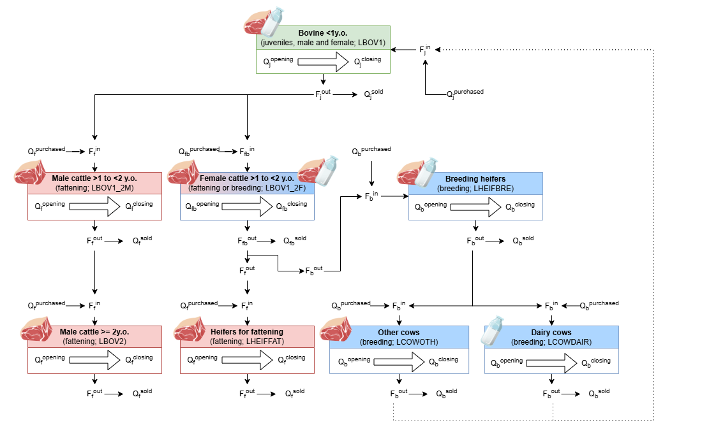

# Why agricultural practice inference is needed {#sec-method-practices-intro}

Our final objective is to estimate the environmental footprint of
agricultural products. This requires first to characterize farming
practices effectively implemented at the farm level, and that are not
directly registered in Farm Accountancy Data Network (FADN).
Specifically, we infer nine agricultural practices from FADN variables
and six more when adding Land Parcel Identification System (LPIS)
associated with Small Woody Feature (SWF) and Ground cover from
SENTINEL-2 data, and parameters from national greenhouse gas inventories
from UNFCCC (@tbl-practice-list).

::: {#tbl-practice-list}
+------------+------------+------------+------------+
|            |            |            |            |
+============+============+============+============+
|            | Data       | FADN (+    | \+ LPIS &  |
|            | source /   | Farm       | SWF \|     |
|            | Practices  | practices  | Parameters |
|            |            | survey &   | &          |
|            |            | feed       | SENTINEL-2 |
|            |            | tables for | \| from    |
|            |            | allocation | national   |
|            |            | keys) data | (farm      |
|            |            |            | level) \|  |
|            |            |            | GHGIs      |
|            |            |            | (yearly \| |
|            |            |            | national   |
|            |            |            | \|         |
|            |            |            | averages)  |
|            |            |            | and \|     |
|            |            |            | other      |
|            |            |            | reference  |
+------------+------------+------------+------------+
| Crop       | N          | Hedge      |            |
| practices  | fertilizer | density    |            |
|            | quantity,  |            |            |
|            | organic    | Mean Field |            |
|            | and        | Size       |            |
|            | mineral    |            |            |
|            |            | Ground     |            |
|            | Pesticides | Cover      |            |
|            |            |            |            |
|            | Tillage    |            |            |
|            |            |            |            |
|            | Crop       |            |            |
|            | Diversity  |            |            |
|            |            |            |            |
|            | Yields     |            |            |
+------------+------------+------------+------------+
| Grassland  | N          | Hedge      | Yield      |
| practices  | Fertilizer | density    | (Agreste   |
|            | quantity,  |            | SAA 2020)  |
|            | organic    |            |            |
|            | and        |            |            |
|            | mineral    |            |            |
|            |            |            |            |
|            | Livestock  |            |            |
|            | density    |            |            |
+------------+------------+------------+------------+
| Herding    | Feed       |            | Manure     |
| practices  | intake     |            | Management |
|            |            |            | System     |
|            | Rearing    |            |            |
|            | parameters |            | Animal     |
|            |            |            | Weight     |
|            | Production |            |            |
|            | yields     |            |            |
+------------+------------+------------+------------+

List of agricultural practices inferred by the FADN2Footprint package,
based on FADN data, potentially combined with data from LPIS, SWF,
SENTINEL-2, and national GHGIs.
:::

To infer these practices, we used several FADN primary variables:

::: {#tbl-practice-FADN-variable}
+--------------------------+--------------------------+
| Agricultural practices   | FADN variable            |
+==========================+==========================+
| Mineral nitrogen         | Crop areas (ha)          |
| quantity (kgN/ha)        |                          |
|                          | Amount of mineral        |
|                          | nitrogen fertilizer      |
|                          | (kgN)                    |
+--------------------------+--------------------------+
| Organic nitrogen         | Crop areas (ha)          |
| quantity (kgN/ha)        |                          |
|                          | Feed intake (see below)  |
|                          |                          |
|                          | Animal number and        |
|                          | category                 |
+--------------------------+--------------------------+
| Pesticides (€/ha)        | Crop areas (ha)          |
|                          |                          |
|                          | Pesticides purchases (€) |
+--------------------------+--------------------------+
| Tillage (L/ha)           | Crop areas (ha)          |
|                          |                          |
|                          | Off-road diesel          |
|                          | purchases (L)            |
+--------------------------+--------------------------+
| Crop diversity (Shannon  | Crop areas (ha)          |
| index, no unit)          |                          |
+--------------------------+--------------------------+
| Crop Yield (tDM/ha)      | Crop areas (ha) and      |
|                          | production (tDM)         |
+--------------------------+--------------------------+
| Livestock density        | Grassland and feedcrops  |
| (LU/ha)                  | areas (ha)               |
|                          |                          |
|                          | Animal number and        |
|                          | category                 |
+--------------------------+--------------------------+
| Feed intake (tDM/LU/yr)  | Crop production and\     |
|                          | sales                    |
|                          |                          |
|                          | Animal number and        |
|                          | category                 |
|                          |                          |
|                          | Feed purchases           |
+--------------------------+--------------------------+
| Rearing parameters (yr)  | Animal number and        |
|                          | category                 |
|                          |                          |
|                          | Animal sales and         |
|                          | purchases                |
+--------------------------+--------------------------+
| Animal yield             | Animal number and        |
|                          | category                 |
|                          |                          |
|                          | Animal product           |
|                          | production (milk, meat,  |
|                          | ...)                     |
+--------------------------+--------------------------+

FADN variables used to infer agricultural practices
:::

# Crop practices {#sec-method-practices-crops}

## Tillage {#sec-method-practices-tillage}

Tillage intensity (L diesel ha⁻¹) is estimated from farm-level off-road
diesel consumption. The direct-seeding reference is 54 L/ha, calculated
as the mean of the values for wheat (60 L/ha), maize (48 L/ha), and a
wheat–maize rotation (54 L/ha) reported by Chenu (2013). This reference
is multiplied by the farm's total recorded crop area, including
grassland. Any positive excess is divided by the farm's arable area to
obtain the tillage intensity assigned to arable crops; negative excess
is set to zero. Grassland is assigned a tillage intensity of zero. For
arable crop records with positive area on farms with arable area,
missing or non-positive off-road diesel consumption results in a missing
tillage intensity.

The implicit assumption is that average off-road diesel use on farms
practicing direct seeding broadly corresponds to diesel used for other
interventions than tillage. Tillage generally represents *43*% of
off-road diesel consumption due to mechanization in cereal fields (Chenu
and Butault, 2015), so total consumption is already highly correlated
with tillage intensity.

## Nitrogen fertilization {#sec-method-practices-Nferti}

The intensity of nitrogen fertilization is estimated for both mineral
and organic fertilizers. For mineral fertilizers, the amount of mineral
nitrogen brought to the farm is allocated to the different crops using
the French average mineral nitrogen input per crop as a distribution key
(Ministère De L’Agriculture - SSP, 2019) (see “PKGC_N_ferti” sheet of
Appendix C in Huet et al., 2026). The farm-level quantity is taken from
the FADN quantity variable where it is available (from 2017 onward). For
earlier years, it is inferred in two steps. First, mineral-N quantity is
estimated from fertiliser expenditure (SE295) using a country- and
year-specific ratio derived from FADN quantity-to-expenditure ratios and
Eurostat fertiliser price indices. This preliminary estimate is then
calibrated with a generalized additive model (GAM) fitted to FADN
observations from 2017 onward, when both expenditure and reported
quantity are available. The Tweedie GAM predicts reported quantity from
a smooth of the preliminary estimate, with country, farm type (TF14),
and economic size class (SIZC) as categorical effects; it is fitted by
REML with the smoothness parameter fixed at 10. Training observations
whose preliminary estimate exceeds its mean by more than three standard
deviations are excluded.

For pre-2017 farms with positive fertiliser expenditure, the model's
prediction on the log scale is exponentiated to give the inferred
quantity. If expenditure is not positive, the inferred quantity is set
to zero. From 2017 onward, the reported quantity is used directly where
available; it is not replaced by a model prediction when missing. During
prediction, TF14 classes 46 and 47 are mapped to class 45 to use the
fitted GAM coefficients; the recorded farm classification is unchanged.

For organic fertilizers, as the FADN variable is not well-informed, we
estimate these inputs in two different ways, depending on whether or not
the farm has livestock.

For farms without livestock, a standard value, equal to the French
average organic nitrogen input for farms that do not produce organic
manure is added to the different crops, distinguishing between organic
and conventional farms (ranging from 2.9 to 151 kgN/ha for conventional
soybean and fodder maize, respectively, Ministère De L’Agriculture -
SSP, 2019; see “PKGC_N_ferti” sheet of Appendix C in Huet et al., 2026).

For farms with livestock, we consider that the total amount of nitrogen
excreted by the farm herd is spread on-farm. The amount of nitrogen
excreted by livestock is calculated at the farm scale, and then
allocated among the different crops. The calculation of nitrogen
excretion by animals is based on the livestock population reported in
FADN and the estimation of the feed quantity and nutritional quality of
the ration provided to these animals (see Section 2.7.1), in accordance
with IPCC recommendations (Calvo Buendia et al., 2019; Eggleston et al.,
2006).

The allocation of excreted nitrogen to crops and grasslands uses the
all-farm average organic nitrogen input per hectare as a distribution
key, distinguishing between organic and conventional farms (Ministère De
L’Agriculture - SSP, 2019; see `data_extra$PKGC_N_ferti`). Averages and
confidence bounds for farms producing their own manure are used
separately to help define the lower and upper allocation thresholds (see
`data_extra$PKGC_N_ferti_org`).

If the resulting amount of the allocation for a given crop or grassland
is smaller than the lowest value between i) the French average organic
nitrogen input for farms that do not produce organic manure (e.g., 9.6
kgN/ha for conventional soft wheat) and ii) the lower bound of the 95%
confidence interval of the average of organic nitrogen inputs of farms
producing their own organic manure (e.g., 55 kgN/ha for conventional
soft wheat, Ministère De L’Agriculture - SSP, 2019), we assign the
lowest of these two values instead (implicitly concluding that despite
having a few animals, these farms import manure).

At the opposite, if the resulting amount is greater than the highest
value between i) the French average organic nitrogen input for farms
that do not produce organic manure (e.g., 9.6 kgN/ha for conventional
soft wheat) and ii) the higher bound of the *95*% confidence interval of
the average of organic nitrogen inputs of farms producing their own
organic manure (e.g., 116 kgN/ha for conventional soft wheat, Ministère
De L’Agriculture - SSP, 2019), we assign the highest of these two values
instead (implicitly concluding that these farms have too many animals
per hectare and therefore export manure).

In addition, the proportion of mineral nitrogen on total nitrogen input
to crops is used as an input variable for the biodiversity model
(Lindner et al., 2019).

## Pesticide use {#sec-method-pesticides}

The intensity of the application of pesticides is estimated using the
purchased value (€) in pesticides recorded in the FADN. This value is
allocated to the different crops using the national average Treatment
Frequency Index (TFI) as a distribution key (Ministère De
L’Agriculture - SSP, 2019) (see “IFT_ref” sheet of Appendix C). We
accounted for the lower toxicity of products used in organic farming by
correcting the value in pesticides of organic farms by the ratio between
the average toxicity of products used in organic farming and the average
toxicity of products used in conventional agriculture, estimated as
follows.

To assess the average toxicities of products used either in organic or
conventional farming, we estimate the toxicity by dose of four among the
top ten best-selling products in each of these production modes (BNV-D,
2020). We select these four products for the availability of data to
determine their toxicity, by multiplying their “freshwater ecotoxicity”
characterization factor (Andreasi Bassi et al., 2023) by their unit dose
(Ministère de l’agriculture, de l’agroalimentaire et de la forêt, 2017).
In line with the ADEME proposal for environmental labeling (ADEME,
2024), the characterization factor is doubled for organic molecules
compared to inorganic molecules (e.g., copper). Then, we calculate the
average toxicity of products used in organic or conventional agriculture
as the weighted average of the toxicity of the four products by the
corresponding number of unit doses (NODU) used in France in 2020 (see
“A.5.1_substance_top10” sheet of Appendix C in Huet et al., 2026). As a
result, we estimate that each euro spent on plant protection in organic
farms is 3.82 times less toxic than a plant protection euro in
conventional farms.

# Landscape variables {#sec-method-practices-landscape-var}

To take into account the landscape dimension of agricultural practices,
we estimate four parameters: hedge density, mean field size, crop
diversity and ground cover. To calculate the variables necessary for
estimating these parameters, we first extract from the French LPIS (IGN,
2020) all plots from farms registered our FADN database for the same
year.

To extract these plots, we use the PACAGE plot numbers (identification
number of the plot in the Common Agricultural Policy registration) as
primary join key. We face two situations:

- The farm has the same PACAGE number in FADN: then the LPIS plots with
  this PACAGE number are associated with that FADN-AC-FQS farm;

- No PACAGE number is registered in the FADN , or the PACAGE number in
  FADN does not correspond to a LPIS PACAGE number: no plot is
  associated the FADN holding. In 2020, such cases are found for 443 and
  318 metropolitan farms, respectively. These holdings are mainly
  concentrated in the OTEX viticulture, market gardening and pig and/or
  poultry farming.

This extraction results in a subsample of the LPIS that we intersect
with the Hedges layer of the BD TOPO® database (IGN and ASP, 2020) to
determine the variables required to estimate the three parameters.

## Hedge density {#sec-method-practices-hedge}

Hedge density is the ratio of the sum in linear meters of hedge to the
area of the holding (UAA). For the calculation of linear lengths, we use
the same procedure as previously used in a similar work at the scale of
the regions of France (Bamière et al., 2023).

Firstly, we expand the LPIS blocks. Hedges are not always inside,
outside or at the edge of LPIS blocks (all three cases present).
However, they rarely cut a block in half. The first step is to expand
the LPIS blocks by a buffer zone of 10 m. The length of 10 m for the
buffer zone is determined visually. It seems that beyond 10 m, it is
common to make mistakes when combining a hedge with two blocks which are
actually separated by a road. Conversely, below 10 m, it seems common to
fail to associate a hedge to a field which is clearly its direct
neighbour.

Secondly, we intersect the hedge lines with the expanded blocks to
determine a border length. There are four cases for each piece of hedge
from the intersection:

1.  The piece of hedge does not intersect any enlarged block. The piece
    of hedge is considered to be lined with non-agricultural uses on
    both sides and twice its length is assigned to “No crop”.

2.  The piece of hedge intersects a single expanded block. The piece of
    hedge is considered to be bordered by agricultural use on one side,
    and non-agricultural use on the other. Its length is assigned once
    to the crop/grassland type of the block and another time to “No
    crop”.

3.  The hedge piece intersects two blocks. The hedge piece is considered
    to be bordered on both sides by agricultural use. Its length is
    assigned once to the type of crop/grassland of each block.

4.  The piece of hedge intersects more than two blocks. Its length could
    then be affected more than twice, which would be absurd (hedge with
    more than two sides). To avoid this, the corresponding lengths are
    multiplied by the ratio of the initial length and the sum of the
    affected lengths so that the sum of the corrected lengths is exactly
    equal to twice the length of the actual hedge (two sides).

Then, to calculate the hedge density for each farm, we distinguish four
plot categories for each variable (hedge length and UAA):

- Total

- Permanent grassland (including grasslands, moors and alpine pastures)

- Arboriculture (including vines)

- Other crops

## Mean field size {#sec-method-practices-mean-field-size}

The mean field size is the ratio of the UAA to the number of plots. We
distinguish four plot categories for each variable (UAA and number of
plots):

- Total

- Permanent grassland (including grasslands, moors and alpine pastures)

- Arboriculture (including vines)

- Other crops

## Crop diversity {#sec-method-practices-crop-div}

We calculate the Shannon index (@eq-shannon), using the number of crops
as the number of species and the surface area as the abundance, only for
arable land use type at the farm scale:

$$H' = - \sum_{i=1}^{R} p_i ln p_i$$ {#eq-shannon}

where $R$ is the total number of crops, and $p$ is the ratio of the area
for the crop $i$ on the total arable area.

## Ground cover {#sec-method-practices-ground-cover}

The vegetation cover data is generated from the Sentinel-2 (S2) raster
data (European Space Agency, 2022). The native S2 data are reflectances
measured every 5 days in the optical range with 10 m resolution pixels
(Level 1C) in metropolitan France. Because of clouds, shadows, aerosols
optical thickness and water vapor, those data were not directly usable.
Therefore, they were corrected (to the so-called Level 2A) with the MAJA
atmospheric correction processor (https://www.cesbio.cnrs.fr/maja/). The
vegetation was then detected with a method based on the calculation of
the NDVI (Normalized Difference Vegetation Index; Araya et al., 2018;
Bockstaller et al., 2021) for the crop year 2020 (i.e., the period from
01/10/2019 to 30/09/2020, summing 366 days as 2020 is a leap year). The
NCD (Number of Covered Days) was then calculated: a day was counted as
“green” if the NDVI is greater than a threshold of 0.3 that separates a
bare soil state to a vegetated soil state (Araya et al., 2018). Because
of the big amount of native data to manipulate (about 4.5 TB), the NCD
at 10 m pixel level was produced using the IOTA2 processing chain
(https://docs.iota2.net/) on the CNES supercomputer HAL. From the NCD,
we calculated the plot average number of covered days using the area
statistics algorithm in QGIS (QGIS Development Team, 2022) for four plot
categories:

- Total

- Permanent grassland (including grasslands, moors and alpine pastures)

- Arboriculture (including vines)

- Other crops

The number of uncovered days is then calculated as: Number of uncovered
day = 366 – number of covered day.

# Practices in grasslands {#sec-method-practices-grasslands}

For grasslands, we consider four agricultural practices: hedge density,
total nitrogen fertilization as well as the share of mineral fertilizer
and livestock density, estimated as the number of grazing animals (e.g.,
cattle, sheep, horses) per hectare of main forage area (e.g., grass,
green maize). Indeed, permanent grasslands are not ploughed, do not
receive pesticides, and are not associated with any crop diversity. We
also considered negligible the effect of mean field size on biodiversity
in grasslands as few studies are available and report contradictory
effects (Dumont et al., 2016; Lescourret et al., 2025)). Permanent
grasslands also have a year-round ground cover. Note that temporary
grasslands are considered as crops as they are part of a crop rotation.

# Herding practices {#sec-method-practices-herding}

To estimate practices associated with livestock, we need to estimate
five main elements:

- herd/flock structure

- herd feed

- other inputs

- manure/waste management

- Animal products

When these elements are estimated, we can model the pseudo-farm by
gathering on-farm practices as well as off-farm ones (e.g., purchased
feed, breeders and juveniles needed to generate fattening livestock).
Then, we calculate the footprint of the whole pseudo-farm.

For herds, we subdivide animals, feed and waste to each farm activity
(e.g. milk vs specialized meat) as recommended (ILCD, 2010). However, we
cannot use subdivision for products coming from the same livestock
category (ie., milk and cull meat from dairy cows). When subdivision is
not possible, we allocate the environmental footprint to the different
co-products using an economic allocation.

## Herd structure {#sec-method-practices-herd-struct}

To estimate the herd structure in each farm, we use the FADN data on
numbers of animals in each livestock category (e.g., dairy cows,
fattening pigs) as well as sales and purchases to estimate in- and
outflows between categories and rearing parameters. Then, to account for
the off-farm animals that generated or have been generated by on-farm
animals (e.g., in a farm specialized in fattening, the off-farm
reproducing cows which mothered the fattening young bovines), we model a
theoretical herd at equilibrium for each livestock category (i.e.,
encompassing both off- and on-farm animals needed to maintain the
observed on-farm animal numbers), using stocks, flows and rearing
parameters of the farm. We call it the pseudo-herd. This is similar to
the LCA approach which would add the environmental footprint of
purchased animals and allocate part of the on-farm footprint to animals
sold to be reared elsewhere. We chose the pseudoherd because it allows
for an estimated environmental footprint of the end-product of these
sold animals (e.g. kg pig meat instead of euros of piglet sold to be
fattened elsewhere). Note that for poultry, we consider off-farm animals
negligible (e.g., the hens that generated the broilers) and hence
neglect flows between categories.

### Modeling farm rearing process {#sec-method-practices-rearing}

To estimate the herd structure, we reproduce rearing processes with
livestock categories of cattle, swine and poultry that we classify in
three rearing stage: juveniles, fattening, or breeders
(@fig-herd-flows). Note that we consider only FADN livestock categories
for which we have a least one animal in the EU over 20XX-20XX (which
excludes XX lister les catégories exclues sauf si elles sont trop
nombreuses, le cas échéant, donner 2 exemples).

::: {#fig-herd-flows}
 


Rearing process charts for cattle, swine and poultry. For each livestock
category, the corresponding rearing stage (i.e., juveniles in green,
fattening in red, and breeders in blue) and the FADN code are mentioned
in brackets. Some heifers may go directly from LBOV1_2F to the breeding
stage without transiting by the LHEIFBRE category. Where this happens,
it artificially decreases the average residence time in the LHEIFBRE
category, which should therefore be interpreted. On the other hand, it
simplifies the expression of age at first calving (see section
\ref{#sec-method-practices-rearing-param}).
:::

While stocks are registered in the FADN for each livestock category
(i.e., average, opening, closing, purchases, and sales numbers), flows
of animals transiting through each livestock category are unknown. We
consider the observed animal stock as the reported average number of
animals (variable "AN"), when available, or the average livestock unit
converted to animal numbers using the conversion coefficient otherwise.

#### Estimation of flows \label{sec:estimation_of_flows}

While flows between categories are unknown, outflows of the last rearing
stages (e.g., LCOWDAIR, LBOV2) correspond to $F^{out} = Q^{sales}$ XX
sold ou sales, il faut choisir et rester cohérent sur le nom de variable
XX and serve as basis to calculate other flows, by tracing back flows
upward the rearing process (@fig-herd-flows). Hence, using outflows of
the last rearing stage as well as quantities registered in the FADN for
each livestock category (i.e., average, opening, closing, purchases, and
sales numbers), we estimate flows of animals transiting through each
livestock category as:

$$
F_{l}^{in} = \Delta \text{Stock}_{l} + F_{l}^{out}
$$ {#eq-Fin}

$$
\Delta \text{Stock}_l = Q_{l}^{closing} - Q_{l}^{opening}
$$ {#eq-delta_stock}

$$
F_{l-1}^{out} = Q_{l-1}^{sales} + \sum_{k \in L} (\max(0, F_{k}^{in} - Q_{k}^{purchases}))
$$ {#eq-Fout}

where $F$ are flows $in$ or $out$ the considered livestock category $l$
(encompassing all animals entering or leaving the category; upward
category $l-1$), L is the ensemble of categories directly downward to
$l-1$ and $Q$ are registered numbers of animals (i.e., $average$,
$opening$, $closing$, $purchases$, or $sales$).

Note that some farms can experience animal losses, resulting in negative
flows. Losses are not recorded, so they are generally assumed to be
null. When the resulting calculation produces negative inflows or
outflows, these are set to zero.

#### Estimation of rearing parameters {#sec-method-practices-rearing-param}

For each livestock category, we estimate the mean residence time (i.e.,
the time spent in that category) following @eq-rearing_time, similar to
residence time in fluid mechanics, estimated as the amount of fluid
stored on the fluid flow rate.

$$t_{l} = \frac{\bar{Q}_{l}}{\frac{F_l^{in}+F_l^{out}}{2}}$$
{#eq-rearing_time}

where $t$ is the average time an animal spends in the livestock category
$l$ (in years), $Q_{l}$ is the observed animal stock (see @eq-Qobs) in
the farm and $F_{l}$ are in- and outflows.

We also estimate the number of offspring per female breeder per year as:

$$Offsprings = \frac{F_{j}^{in} - Q_j^{purchases}}{\bar{Q}_{b}}$$
{#eq-offspring_nb}

where $F_{j}$ and $Q_j$ are juvenile flow and number of animals, and
$Q_b$ are breeder numbers of animals.

For cattle, we also estimate the average age at first calving which,
thanks to our artefactual assumption that all heifers go through the
LHEIFBRE category, is simplified to:

$$ age\_at\_first\_caliving = 1 + t_{LBOV1\_2F} + t_{LHEIFBRE} $$

In some farms, some livestock categories have zero quantity (e.g., a pig
fattener without piglets and sows), preventing the estimation of
associated rearing parameters. When the rearing parameter is not
available or infinite, we replace the missing value by the corresponding
median in farms of the same NUTS2 where the livestock category is
present when at least 15 such farms are available. Otherwise, we use the
reference median for that parameter (see below).

#### Reference median and outlier handling for rearing parameters {#sec-ref-rearing-param}

Rearing parameters used throughout the pseudo-herd estimation (turnover
rates, time to first calving, offspring rate; see
@sec-method-practices-rearing-param and
@sec-method-practices-livestock-mixed-cat) cannot be estimated for every
farm (e.g., a zero-quantity category) and can take unrealistic values
when flows are poorly reported. For each parameter, non-finite and
missing values are replaced by a reference value: the median value of
that parameter among reference farms of the same NUTS2 region, or, if
that NUTS2 has fewer reference farms than a minimum threshold (i.e., 15
farms), the reference median (@sec-ref-rearing-param). The resulting
value (observed or imputed) is then clipped to a parameter-specific
`[threshold_down, threshold_up]` interval derived from the pan-European
reference distribution (@sec-ref-rearing-param). Lower and upper
thresholds correspond to 1st, 5th, or 10th and 90th, 95th, or 99th
percentiles, respectively, of the considered rearing parameter
distribution, depending on the stringency desired. The desired
stringency is determined by examining the distribution of the rearing
parameter and identifying outliers visually. Note that the maximum
threshold for categories whose age is specified is logically determined
by this definition (e.g., female bovine between 1 and 2 y.o. have a
maximum residence time of 1).

The reference medians and thresholds themselves are pre-computed once,
from the pan-European FADN data over 20XX-20XX, and bundled with the
package as the `reference_rearing_param` dataset
(`inst/scripts/pseudoherd_reference_table.R`); they are not recomputed
from the farms being processed.

This correction is applied once to the primary rearing parameters
(computed from raw animal flows) and a second time to the rearing
parameters of mixed categories (computed from the subdivision step of
@sec-method-practices-livestock-mixed-cat, and therefore depending on
the first correction). XX Je comprends pas le besoin d'appliquer une
deuxième fois. Je ne comprends même pas en quoi consiste l'application
du filtre la deuxième fois : les flux, offspring, etc. ne sont pas
recaclulés, donc qu'est-ce que tu clippes ?XX

#### Subdivision: estimation in mixed categories {#sec-mixed-categories}

In rearing processes, some livestock categories encompass both animals
for fattening and for breeding. For instance in cattle, while heifers
(i.e., female more than two y.o. which have not yet calved) are already
distinguished in the FADN between fattening and breeding ones, female
below two y.o. are not (@fig-herd-flows). In such mixed category, only
the number of animals sold are differentiated between sales for
slaughtering and those for rearing. We consider that sales for rearing
are for breeding purposes and that sales for slaughter are fattened
animals (i.e., $Q_{B}^{sales}$ and $Q_{F}^{sales}$, respectively; see
section Animal products). For other numbers (i.e., observed, average,
opening, closing, and purchases) in these mixed categories, we
distinguish animals going to be fattened from those going to be breeders
based on their proportion in the downward flow of animals (see Eq.
@eq-mixed_cat for an example calculation of the observed number of
animals for fattening). For the mixed category LBOV1_2F, the downward
fattening flow consists of slaughter sales from that category plus the
inflow to LHEIFFAT not explained by purchases. The downward breeder flow
is the remaining outflow from LBOV1_2F.

$$
\begin{aligned}
F_{f,l}^{out} &= Q_{l,\mathrm{slaughter}}^{sales}
  + F_{f}^{in} - Q_{f}^{purchases} \\
F_{b,l}^{out} &= F_{fb,l}^{out} - F_{f,l}^{out} \\
\bar{Q}_{f,l} &= \bar{Q}_{l} \cdot
  \frac{F_{f,l}^{out}}{F_{f,l}^{out} + F_{b,l}^{out}} \\
\bar{Q}_{B,l} &= \bar{Q}_{l} \cdot
  \frac{F_{b,l}^{out}}{F_{f,l}^{out} + F_{b,l}^{out}}
\end{aligned}
$$ {#eq-mixed_cat}

where $F_{f,l}^{out}$ and $F_{b,l}^{out}$ are inferred downward flows
from mixed category $l$ into the fattening and breeder pathways,
respectively (see section \ref{sec:#estimation_of_flows}XX les renvois
n'ont pas l'air de fonctionner. Par ailleurs, il faut garder une
notation cohérente. J'ai fait des changements en ce sens, mais c'est
toujours pas parfait : ça ne correspond pas aux noms de variables de la
figure avec les flux. Assurez cette cohérenceXX). For LBOV1_2F, $l+1$ is
LHEIFFAT. The observed stocks are split in proportion to these flows;
this allocation does not use downstream stocks divided by residence
times.

### Restrain herd animals to farm activities {#sec-restrain-activities}

We allocate observed animals between different farm activities (i.e.,
milk, meat, and eggs).

#### Cattle {#sec-restrain-cattle}

**Cattle milk activity** For cattle, we first estimate animals involved
in the dairy herd with Equation @eq-restrain_herd_act. We consider that
farmers will prioritize the renewal of dairy cows and thus estimate
which animals are needed to maintain the dairy herd as follows:

$$
\bar{Q}_{l-1, \; \text{milk}} = \min(\bar{Q}_{l-1}, t_{l-1} \cdot \frac{\bar{Q}_{l, \; \text{milk}} }{t_{l}})
$$ {#eq-restrain_herd_act}

Hence, the number of dairy cows (`LCOWDAIR`) fully determines the
renewal chain. All dairy cows are attributed to the milk activity, and
the renewal categories — heifers for breeding (`LHEIFBRE`) and the
breeding share of `LBOV1_2F` — are derived from the dairy-cow turnover
rate and their own turnover rate (@eq-restrain_herd_act); juveniles
(`LBOV1`) needed to generate these future breeders are derived
similarly, considering that the first rearing stage of `LBOV1` leading
to `LBOV1_2F` breeders has, by definition, a residence time of 1 year.

The observed number of animals involved in the milk activity
($\bar{Q}_{l,\;milk}$, `f_herd_activities()`) are capped so that they
never exceed a category's actual on-farm stock.

**Cattle meat activity.** We consider all additional cattle (i.e., not
needed for the milk activity) as part of the meat activity (e.g.
additional calves spawned from dairy cows).

#### Swine {#sec-restrain-swine}

For swine, all animals are involved in the meat activity.

#### Poultry {#sec-restrain-poultry}

For poultry, we consider that all animals needed in the production of
either eggs (i.e., laying hens) or meat (i.e., broilers and other
poultry) are present on-farm, the pseudo-herd thus equaling the herd.

#### Sheep {#sec-restrain-sheep}

For sheep, we assume that a ewe produce 255 l/year in France (CAP2ER,
2025) and thus estimate the number of ewes involved in the milk activity
as $Qobs_{milk} = round(prod_t / 0.255)$ (where $prod_t$ is the milk
production in tonnes and round gives the closest integer). We assign at
least one ewe to the milk activity if the farm has any milk production,
even if it is below 122.5 l/year.

As for cattle, all other ewes (LEWEBRE) and sheeps (LSHEPOTH) are
assigned to the meat activity.

#### Goats {#sec-restrain-goats}

For goats, all animals are involved in the milk activity.

### Estimation of pseudo-herd {#sec-method-practices-pseudoherd}

When considering only on-farm animals, one can miss a substantial part
of the impact of a production. For instance, beef comes from bovine
animals that were once calves spawned by suckler cows: the beef impact
should hence encompass the slaughtered bovine impact as well as the
calve and suckler cow ones, even when these are not present on the same
farm. Similarly, dairy cows spawn more calves than needed to renew the
dairy herd and these additional calves are slaughtered to produce veal
or raised longer to produce beef: some of the impact of dairy cows
should therefore be attributed to beef or veal meat, even if they are
not raised on the farm.

The pseudo-herd includes all animals involved in a specific activity
(e.g., slaughtered bovine, calves and suckler cows for beef; fattening
pigs, piglets and breeding sows for pork; etc.), whether they are
present on-farm or not (i.e., off-farm). We estimate the pseudo herd by
calculating the number of animals needed to sustain the herd, as
follows.

To estimate the total number of both on- and off-farm animals involved
in the rearing process, we compute what would be the herd at equilibrium
based on the actual stock in each rearing stage (i.e., juveniles ,
fattening or breeders), and the rearing parameters already estimated
(@sec-method-practices-rearing-param).

Equilibrium values estimated based on fattening quantities can only be
estimated by going upwards (i.e. how many calves are necessary to
sustain this number of fattening animals?), because the fattening stage
is a "dead-end" without downward stages. For the same reason,
equilibrium fattening quantities based on other categories can only be
estimated by going downwards. However, for estimating breeders based on
juveniles or vice-versa, we could in principle go both ways. We choose
the way with the fewest number of parameters, that is in both cases
using the number of offspring per breeder and per year (upwards when
estimating breeders based on juveniles, and downwards when estimating
juveniles based on breeders).

### Cattle {#sec-pseudoherd-cattle}

**Cattle milk activity.** There can never be too few dairy cows to
sustain the herd, because our subdivision procedure between milk and
meat has already allocated excess juveniles or fattening animals to the
meat activity. The pseudo-herd equilibrium quantities
($\widehat{Q}_{l,\;milk}$, `f_pseudoherd_cattle()`) are therefore
computed downward from dairy cows, with the very same equations than for
restraining activities but **without** the cap on observed number of
animals (@sec-restrain-cattle):

$$
\widehat{Q}_{l-1, \; \text{milk}} = t_{l-1} \cdot \frac{\bar{Q}_{l, \; \text{milk}} }{t_{l}}
$$

As a result, $\widehat{Q}_{l,\;milk}$ can exceed $\bar{Q}_{l,\;milk}$
for the renewal categories whenever a farm does not raise, on-farm, all
of the heifers and calves required to renew its own dairy herd — these
additional animals constitute the off-farm part of the dairy
pseudo-herd.

**Cattle meat activity.**

For cattle involved in the meat activity, juveniles can either move
downwards to another rearing stage or be slaughtered as veal. Estimated
equilibrium fattening quantities involving the juvenile stage are
therefore adjusted by the ratio of calves destined rearing to total
juvenile outflow, $(1-Q_{LBOV1}^{slaughtering}) / F_{LBOV1}^{out}$, when
juvenile outflow is positive (@tbl-pseudoherd_eq). Where
$Q_{LBOV1}^{slaughtering}$ is not specified, it is obtained by applying
the average fraction $Q_{LBOV1}^{slaughtering}/Q_{LBOV1}^{sold}$ at
NUTS2 level (or at EU level if fewer than 15 farms at NUTS2) to the
observed farm-level $Q_{LBOV1}^{sold}$. XX tableau ci-dessous n'a pas
été mis à jourXX

::: {#tbl-pseudoherd_eq}
```{r tbl-pseudoherd_eq, echo=FALSE, message=FALSE, warning=FALSE}

library(gt)
library(dplyr)

# Use MathJax inline delimiters for HTML rendering
allocation_data <- data.frame(
    row_label = c(
        "$$\\bar{Q}_{j}$$",
        "$$\\bar{Q}_{f}$$",
        "$$\\bar{Q}_{b}$$"
    ),
    col_j = c(
        "—",
        "$$t_j \\cdot \\left(\\frac{\\bar{Q}_{f}}{t_f}\\right)$$",
        "$$t_j \\cdot \\bar{Q}_{b} \\cdot \\text{Offsprings}$$"
    ),
    col_f = c(
        "$$t_f \\cdot \\left(\\frac{\\bar{Q}_{j}}{t_j}\\right)$$",
        "—",
        "$$t_f \\cdot \\bar{Q}_{b} \\cdot \\text{Offsprings}$$"
    ),
    col_b = c(
        "$$\\frac{\\bar{Q}_{j}}{t_j} \\cdot \\frac{1}{\\text{Offsprings}} - Q_{LCOWDAIR}$$",
        "$$\\frac{\\bar{Q}_{f}}{t_f} \\cdot \\frac{1}{\\text{Offsprings}}$$",
        "—"
    ),
    stringsAsFactors = FALSE
)

# table ----
allocation_data |>
    gt() |>
    cols_label(
        row_label = md(""),
        col_j     = md("$$\\widehat{Q}_{j}$$"),
        col_f     = md("$$\\widehat{Q}_{f}$$"),
        col_b     = md("$$\\widehat{Q}_{b}$$")
    ) |>
    fmt_markdown(columns = everything()) |>
    # Row label column styling
    tab_style(
        style = list(
            cell_fill(color = "#1B4F72"),
            cell_text(color = "white", weight = "bold", align = "center")
        ),
        locations = cells_body(columns = row_label)
    ) |>
    # Column header styling
    tab_style(
        style = list(
            cell_fill(color = "#1A5276"),
            cell_text(color = "white", weight = "bold", align = "center")
        ),
        locations = cells_column_labels(columns = everything())
    ) |>
    # Alternating row backgrounds (excluding row_label column)
    tab_style(
        style     = cell_fill(color = "#D6EAF8"),
        locations = cells_body(columns = c(col_j, col_f, col_b), rows = c(1, 3))
    ) |>
    tab_style(
        style     = cell_fill(color = "#AED6F1"),
        locations = cells_body(columns = c(col_j, col_f, col_b), rows = 2)
    ) |>
    # Diagonal (—) cells highlighted
    tab_style(
        style = list(
            cell_fill(color = "#F0F3F4"),
            cell_text(color = "#717D7E", size = px(16), weight = "bold", align = "center")
        ),
        locations = list(
            cells_body(columns = col_j, rows = 1),
            cells_body(columns = col_f, rows = 2),
            cells_body(columns = col_b, rows = 3)
        )
    ) |>
    # Center all equation cells
    cols_align(align = "center", columns = everything()) |>
    # Column widths
    cols_width(
        row_label ~ px(130),
        col_j ~ px(220),
        col_f ~ px(220),
        col_b ~ px(220)
    ) |>
    # Footnotes
    tab_footnote(
        footnote  = md("For cattle, equilibrium fattening quantities estimated from juveniles or breeders are multiplied by the ratio of calves not sold for slaughter to total juvenile outflow: $\\frac{(F_{LBOV1}^{out} - Q_{LBOV1}^{slaughter})}{F_{LBOV1}^{out}}$, when juvenile outflow is positive."),
        locations = cells_body(columns = col_f, rows = c(1, 3))
    ) |>
    tab_footnote(
        footnote = md("For cattle, subtract observed dairy cows ($Q_{LCOWDAIR}$) from breeder equilibrium estimated from juveniles because dairy cows are included in the breeder quantity."),
        locations = cells_body(columns = col_b, rows = 1)
    ) |>
    tab_source_note(
        source_note = md(
            "**Notation:** &nbsp;
       $t$ = residence time in the category; &nbsp;
       $\\bar{Q}$ = observed number of animals; &nbsp;
       $\\widehat{Q}$ = estimated number of animals; &nbsp;
       $\\{j,f,b\\}$ = rearing stage (i.e., juveniles, fattening or breeders); &nbsp;
       $\\text{Offsprings}$ = number of offspring per breeder"
        )
    ) |>
    tab_options(
        table.font.names                  = "Source Sans Pro, Calibri, sans-serif",
        table.font.size                   = px(13),
        table.border.top.color            = "#1B4F72",
        table.border.top.width            = px(3),
        table.border.bottom.color         = "#1B4F72",
        table.border.bottom.width         = px(2),
        column_labels.border.bottom.color = "#AED6F1",
        column_labels.border.bottom.width = px(2),
        data_row.padding                  = px(14),
        heading.background.color          = "#1B4F72",
        heading.title.font.size           = px(15),
        heading.subtitle.font.size        = px(12),
        footnotes.font.size               = px(10),
        footnotes.marks                   = "standard",
        source_notes.font.size            = px(10),
        table.width                       = pct(90)
    )
```

Equations to estimate theoretical equilibrium stocks of meat
pseudo-herds (cattle meat, sheep meat, swine, poultry) from the number
of on-farm animals Q (encompassing stocks and sales for slaughter) and
rearing parameters (i.e., times and offspring number) depending on the
rearing stage (i.e., juveniles, fattening or breeders). NB : the
"fattening" stage includes all animals of intermediate age,
notwithstanding whether they will ultimately be slaughtered for meat or
reach the next stage as breeders.
:::

For each rearing stage $s$ containing several livestock categories
(i.e., fattening or breeders), we first aggregate the on-farm quantities
attributed to the activity of interest (@eq-Qobs-stage).

$$
\bar{Q}_{s} = \sum_{l=1}^{L_s} \bar{Q}_{l,\;meat}
$$ {#eq-Qobs-stage}

where $L_s$ is the number of livestock categories within stage $s$ and
$\bar{Q}_{l,\;meat}$ is the observed quantity of animals in category $l$
attributed to meat production.

For breeders, where a given animal cannot go through different
categories, the stage-level residence time $t_s$ is trivially the
weighted average of the residence times of its categories. For fattening
bovine however, the rearing stage is decomposed into its five possible
pathways
(`LBOV1_2F -> slaughter, LBOV1_2F -> LHEIFFAT -> slaughter,  LBOV1_2M -> slaughter, LBOV1_2M -> LBOV2 -> slaughter, and LBOV1_2F -> LHEIFBRE_{meat}`)
XX puisque les fattening incluent les futurs breedersXX. The stage-level
residence time $t_s$ is then the weighted average residence time per
pathway (`f_pseudoherd_cattle()`, variables `Qobs_j`, `Qobs_f`,
`Qobs_b`, `rt_j`, `rt_f`).

\$\$

t_f = (t\_{LBOV1_2M}\^{slaughter} *Q\^{slaughter}{LBOV1_2M}* \newline +
(1 + t{LBOV2}) (F\^{out}*{LBOV1_2M} - Q\^{slaughter}*{LBOV1_2M})
\newline

- t\_{LBOV1_2F_fattening}\^{slaughter} \* Q\^{slaughter}\_{LBOV1_2F}
  \newline
- (1 + t\_{LHEIFFAT}) \* (F\^{out}*{LBOV1_2F_fattening} -
  Q\^{slaughter}*{LBOV1_2F}) \newline
- t\_{LBOV1_2F_breeding}\*F\^{out}*{LBOV1_2F_breeding})/
  (F\^{out}*{LBOV1_2M} + F\^{out}\_{LBOV1_2F})

\$\$

where $t_f$ is the stage-level residence time for fattening bovine,
$t_{LBOV1\_2M}^{slaughter}$ is the residence time for the pathway
`LBOV1_2M -> slaughter`, $1 + t_{LBOV2}$ is the residence time for the
pathway `LBOV1_2M -> LBOV2 -> slaughter`,
$t_{LBOV1\_2F\_fattening}^{slaughter}$ is the residence time for the
pathway `LBOV1_2F -> slaughter`, $1 + t_{LHEIFFAT}$ is the residence
time for the pathway `LBOV1_2F -> LHEIFFAT -> slaughter`,
t\_{LBOV1_2F_breeding} is the residence time for the pathway
`LBOV1_2F -> LHEIFBRE_{meat}`, $Q^{slaughter}_{LBOV1\_2M}$ is the
observed quantity of `LBOV1_2M` animals sold directly for slaughter,
$Q^{slaughter}_{LBOV1\_2F}$ is the observed quantity of `LBOV1_2F`
animals sold directly for slaughter, $F^{out}_{LBOV1\_2M}$ is the total
outflow of `LBOV1_2M` animals, and $F^{out}_{LBOV1\_2F}$ is the total
outflow of the `LBOV1_2F` animals (@sec-mixed-categories).

As stated above, the stage used as reference to derive equilibrium
quantities is the stage whose observed quantity $\bar{Q}_s$ is larger
than what would be implied by each of the two other stages (in the code,
this is obtained by selecting the rearing stage with the highest
observed-to-equilibrium ratio). In case of a tie, fattening, as its the
terminal rearing stage, is chosen as the reference.

For cattle, this comparison — and the subsequent computation of
$\widehat{Q}_j$, $\widehat{Q}_f$ and $\widehat{Q}_b$ following
@tbl-pseudoherd_eq — additionally accounts for animals sold directly for
slaughter, which never reach the following rearing stage, through the
estimation of the retention time for fattening animals (@eq-rt_f_cattle)
and through the estimation of the equilibrium quantity of fattening
animals (@tbl-pseudoherd_eq). XX je comprends pas XX

As the pseudo-herd can only be larger than, or equal to, what is
actually observed on the farm, the equilibrium quantity of a stage is
bounded below by its observed quantity ($\widehat{Q}_s \geq \bar{Q}_s$)
to remove any rounding errors.

**Sheep.** For sheep, we apply the same logic as for cattle. We first
estimate the animals needed to renew the dairy ewes (`LEWEBRE`) among
the other sheeps (`LSHEPOTH`, including juveniles and fattening animals)
and allocate all other animals to the meat activity. Then, for sheep
assigned to the meat activity, the equilibrium numbers are balanced
using the observed counts, residence times, and breeder offspring rate.

**Swine.**

For swine, we consider that all animals are involved in the meat
activity. We infer the number of animals at equilibrium as for the
cattle meat activity, with the juvenile stage ($j$) being the single
category `LPIGLET`, the fattening stage ($f$) being the single category
`LPIGFAT`, and the breeder stage ($b$) including `LSOWBRE` and
`LPIGOTH`; all animals in `LPIGOTH`, which includes both male breeders
and cull sows, are assumed to be male breeders XX d'après ton schéma,
c'est ça. Sinon, je comprends ni ce que tu voulais dire, ni ce que tu
faisXX.

**Poultry.**

For poultry, we consider breeders of broilers and juveniles of laying
hens as negligible. There is therfore a single rearing stage, and no
need to estimate equilibrium quantities.

#### Redistribution across livestock categories

For rearing stages with several livestock categories (e.g. fattening or
breeding in the cattle meat activity), the stage-level equilibrium
numbers ($\widehat{Q}_f$, $\widehat{Q}_b$) are redistributed across the
individual livestock categories composing each stage
(`f_pseudoherd_cattle()`, section "Estimate balanced number of animals"
XX mettre un renvoi dynamiqueXX).

For the fattening stage, the equilibrium gap is distributed
proportionally to the share of each category $l$ in the *country-level*
observed stock of its stage, weighted by each farm's economic size
(`SYS02`):

$$share_{l} = \frac{\sum_{\text{farms}} \bar{Q}_{l} \cdot SYS02}{\sum_{\text{farms}} \bar{Q}_{s} \cdot SYS02}, \quad l \in L_s$$ {#eq-share-cat}

$$\widehat{Q}_{l,\;meat} = \bar{Q}_{l,\;meat} + (\widehat{Q}_{s} - \bar{Q}_{s}) \cdot share_{l}$$ {#eq-redistrib-category}

This redistribution was preferred to one based on farm-level shares
because sold calves may go to any farm in the country.

XX Je comprends pas. Le para ci-dessous n'a pas lieu d'être puisque 1)
LBOV1_2F fait partie des "fattening" (y compris la fraction destinée à
devenir breeder) et 2) l'équation ci-dessus gère déjà la réallocation
des fattening.XX

#### Pseudo-herd feed and associated practices

For each off-farm animal, we add the NUTS2 average of feed quantity and
quality estimated from our test data set (see Section Feed). If not
NUTS2 averages are available, we fall back to COUNTRY-level averages.

## Feed intake reconstruction {#sec-method-practices-feed}

### Feed quantity and quality {#sec-method-practices-feed-qty-qlty}

To estimate the quantity and quality (type of) of the livestock feed, we
consider both on-farm (i.e., farm-grown) and off-farm (i.e., purchased)
feed to form a "pseudo-farm". For total quantities, we rely on produced
amounts, sold amounts and purchased values. For their allocation to each
animal category, we rely on a theoretical feed ration constructed for
each farm’s livestock category. Theoretical rations are determined by
combining the total dry matter intake requirements per livestock unit
(derived from the AROPAJ model; Jayet et al., 2023) with the
species-specific volumes of each feed consumed nationally (Sailley et
al., 2021; see “Sailley_2021_feed_flows” sheet of Appendix C in Huet et
al., 2026).

On-farm feed quantity is calculated as the recorded crop production
minus sales. Where FADN records forage area but not production, the
forage yield is imputed using annual Copernicus Dry Matter Production
(DMP)-based estimates for the corresponding crop type and region (see
@sec-method-practices-yields). Purchased feed quantity is estimated
based on FADN expenditure variables for concentrated feedstuffs and
coarse fodder. We first value the theoretical ration using feed prices
(Eurostat, 2022) to determine the theoretical cost share of each
feedstuff per livestock species (concentrates and roughage). The
observed FADN expenditure is then allocated to specific feed types
according to these theoretical value shares. Finally, these allocated
values are converted into physical quantities (tonnes) by dividing by
the corresponding Eurostat unit prices.

This net available on-farm biomass is then allocated to the farm's
livestock categories proportional to their theoretical dry matter
requirements for each crop, concentrated feedstuffs and coarse fodder.

Feed quality parameters - gross energy (GE), crude protein content (CP),
and ash – are calculated by applying nutritional coefficients from feed
tables (Tran, 2002) to the estimated dry matter quantities. To exclude
aberrant estimations, we remove farms with extreme GE supplied to their
main livestock category. Specifically, we exclude farms with a GE
exceeding the mean + 3 × standard deviation (a common threshold in the
literature), below 0.25 × the mean GE for dairy cows (since even
low-producing dairy cows are unlikely to be sustained on less than a
quarter of the average energy intake), or below 0.10 x the mean GE for
non-dairy cow livestock categories (Table A4 in Huet et al., 2026).

### Crop practices for animal feed production {#sec-method-practices-feed-prod-practices}

Then, we estimate the crop practices implemented to produce the feed,
and consider practices associated with both on-farm and purchased feed.

Farming practices associated with on-farm feed are obtained from
farm-specific data (@sec-crop-practices).

Practices associated with purchased feed reflect in-study national crop
averages, distinguishing organic vs conventional, except for soybean
meal. The soybean meals are assumed to be imported from Brazil, and we
retrieve the associated practices of Brazilian soybean production from
Lindner et al. (2022).

## Manure management system assignment {#sec-method-practices-MMS}

The fraction of manure handled by each manure management system (AWMS)
on a farm is not measured directly in FADN for most countries. Instead
AWMS fractions are inferred from UNFCCC CRF tables together with
IPCC/UNFCCC MCF and Bo parameters to compute CH4 and (together with N
excretion and EF) N2O from manure management.

## Animal weight estimation {#sec-method-practices-animal-weight}

Animal weights are not reported in FADN. We use the national animal
liveweights reported in UNFCCC CRF tables.

# Yields (observed vs. imputed) {#sec-method-practices-yields}

Yields in FADN2Footprint are obtained directly from FADN when both crop
area and production are registered. When FADN production is missing —
especially for forage crops and grasslands, where FADN often records
area but not production — annual reference yields are taken from the
Copernicus DMP-based regional dataset in
`inst/ext_data/forage_yield/forage_yields_EU.xlsx`. The dataset provides
green maize, artificial grass, temporary grass, and permanent grass
yields in t DM/ha/year for NUTS3 and NUTS2 regions from 2004 to 2024.
The parser maps the relevant FADN crop codes to these four types and
matches by farm year and NUTS3 region, falling back to NUTS2 when a
NUTS3 estimate is unavailable. Missing production is then calculated as
crop area multiplied by the imputed yield. Observed yields and
production are retained. If no regional reference is available, the
existing FADN-average yield imputation is used.

# Allocation keys: activity-level & product-level disaggregation {#sec-method-practices-alloc}

For crops, we estimate practice intensities at the crop level for within
field practices (fertilization, pesticides use, tillage) and at the
farm-level for landscape variables (hedge density, crop diversity,
ground cover, mean field size). To attribute within field practices to
specific crops within the farm, we use the crop practices survey
(Ministère De L’Agriculture - SSP, 2019) as an allocation key.
